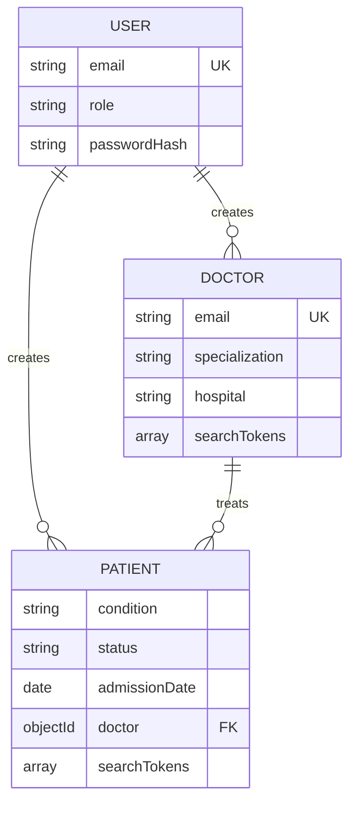

# 🩺 Doctor Tracker — REST API

> A standalone Express 5 API for the Doctor Tracker admin portal. It provides JWT-backed
> authentication, role-aware doctor and patient management, dashboard analytics, and filter
> metadata over MongoDB.

<div align="center">


**Companion application:** Doctor Tracker Frontend · Next.js 16 · maintained in a separate repository

</div>

---

> [!NOTE]
> **For non-technical readers:** this service is the secure data and rules layer behind the clinic dashboard. It checks who is asking, validates what they send, applies role permissions, and reads or updates the database. It supports care coordination; it does not diagnose, prescribe, or replace a clinical record system.

### 🗺️ The service at a glance

| 🔐 Identity                                | 👨‍⚕️ Doctors                             | 🧑‍🤝‍🧑 Patients                               | 📊 Insights                        | 🧰 Data tools                                              |
| ------------------------------------------ | -------------------------------------- | ----------------------------------------- | ---------------------------------- | ---------------------------------------------------------- |
| Sign-in, signed tokens, admin/viewer roles | Search, filters, profiles, assignments | Search, filters, update, reassign, delete | One range-aware analytics overview | Safe demo seeding, declared indexes, query-plan inspection |

```text
Browser / Next.js server  ━━━▶  Express API  ━━━▶  MongoDB
       session + role          validate + authorize       records + indexes
```

**Permissions in one glance**

| Role          | Read doctors, patients, analytics | Create or change records |
| ------------- | :-------------------------------: | :----------------------: |
| 👑 Admin      |                ✅                 |            ✅            |
| 👀 Viewer     |                ✅                 |            —             |
| 🚪 Signed out |   Public health and login only    |            —             |

> [!IMPORTANT]
> This repository contains a local demo-data seeder and sample login accounts for development. Use only synthetic/demo data with those accounts, and never use the demo credentials or `--force` against a production database.

**Local API:** `http://localhost:4000/api/v1`  
**Local Swagger UI:** `http://localhost:4000/api/docs`

No public deployment URL, screenshots, or query-plan capture is committed yet. The deployment
and evidence sections below are intentionally marked as planned or pending rather than claiming
external work that has not been verified.

## 1. Description

Doctor Tracker is a contract-first REST API built with Express 5, Mongoose, Zod, and `jose`. It
serves the portal's authentication, doctor directory, patient records, filter options, and
analytics dashboard. The API validates input at the HTTP boundary, uses a consistent JSON response
envelope, keeps secrets in environment variables, and declares MongoDB indexes alongside the
schemas that use them.

The API accepts bearer tokens rather than browser cookies. A frontend BFF can keep that token in
an httpOnly first-party cookie and forward it server-to-server, while other clients can use the
same API through the standard `Authorization: Bearer <token>` header.

## 2. Setup Guide

### Prerequisites

- Node.js `24.x` (see `package.json`)
- A MongoDB 8-compatible instance: local MongoDB or a MongoDB Atlas connection string
- npm, supplied with Node.js

### Install and configure

Install the locked dependency set:

```bash
npm ci
```

Copy the non-secret template, then replace its placeholder values. On PowerShell:

```powershell
Copy-Item .env.example .env
```

On macOS or Linux:

```bash
cp .env.example .env
```

Generate one shared JWT secret for the backend and the frontend configuration:

```bash
node -e "console.log(require('crypto').randomBytes(48).toString('base64url'))"
```

`.env` is ignored by Git. Do not commit a real database URI, JWT secret, or production origin.
The validated settings are:

| Variable         | Development default     | Notes                                                          |
| ---------------- | ----------------------- | -------------------------------------------------------------- |
| `NODE_ENV`       | `development`           | Accepted values: `development`, `test`, `production`.          |
| `HOST`           | `0.0.0.0`               | Use `127.0.0.1` behind Nginx on a VPS.                         |
| `PORT`           | `4000`                  | HTTP listener port.                                            |
| `LOG_LEVEL`      | `info`                  | Pino level; the example uses `debug`.                          |
| `MONGODB_URI`    | —                       | Required. Use a distinct database name per environment.        |
| `JWT_SECRET`     | —                       | Required; at least 32 characters and shared with the frontend. |
| `JWT_EXPIRES_IN` | `8h`                    | `jose` duration string.                                        |
| `JWT_ISSUER`     | `doctor-tracker-api`    | Must match JWT verification settings.                          |
| `JWT_AUDIENCE`   | `doctor-tracker-web`    | Must match JWT verification settings.                          |
| `BCRYPT_ROUNDS`  | `10`                    | Allowed range: 8–14; use 12 on the planned VPS.                |
| `CORS_ORIGINS`   | `http://localhost:3000` | Comma-separated browser origin allow-list.                     |
| `APP_TIMEZONE`   | `Asia/Dhaka`            | IANA zone used for analytics buckets.                          |

Node's built-in `--env-file-if-exists` option loads `.env`; this project intentionally does not
depend on `dotenv` or `nodemon`.

### Seed local demo data

With a development or test database name ending in `_dev` or `_test`, seed deterministic demo
data:

```bash
npm run seed
```

The seed creates two users, 48 doctors, and 1,500 patients. Its local-only credentials are:

```text
admin@doctortracker.test  /  Admin@12345
viewer@doctortracker.test /  Viewer@12345
```

The seed refuses to wipe another database name unless `--force` is supplied. Do not use those demo
credentials or `--force` casually against a production database.

### Run the API

```bash
npm run dev
```

Then confirm the liveness endpoint:

```bash
curl http://localhost:4000/api/v1/health
```

The server connects to MongoDB before listening. `GET /api/v1/health` reports whether Mongoose sees
the database connection as up, along with uptime and a timestamp.

### Scripts

| Command                                             | Purpose                                                                                |
| --------------------------------------------------- | -------------------------------------------------------------------------------------- |
| `npm run dev`                                       | Run the API in Node watch mode with `.env` loaded when present.                        |
| `npm start`                                         | Run the production entry point.                                                        |
| `npm run seed`                                      | Reset and create deterministic demo data in a `_dev` or `_test` database.              |
| `npm run db:indexes`                                | Synchronize declared schema indexes; review its potential index drops before using it. |
| `npm run lint`                                      | Run ESLint over the repository.                                                        |
| `npm run lint:fix`                                  | Apply ESLint fixes where safe.                                                         |
| `npm run format`                                    | Format files with Prettier.                                                            |
| `npm run format:check`                              | Check formatting without writing files.                                                |
| `npm test`                                          | Run Vitest integration tests.                                                          |
| `npm run test:watch`                                | Run Vitest in watch mode.                                                              |
| `node --env-file-if-exists=.env scripts/explain.js` | Print MongoDB execution-plan evidence for selected queries.                            |

## 3. System Architecture

The API is standalone. The diagram shows the intended production integration; the external frontend
and hosting endpoint are not configured in this repository.

```mermaid
flowchart LR
  Browser[Browser] --> BFF[Next.js BFF / server layer]
  BFF -->|Bearer JWT| API[Express 5 API]
  API --> MW[Security, CORS, JSON, logs]
  MW --> Router[/api/v1 router]
  Router --> Services[Feature services]
  Services --> Models[Mongoose models and indexes]
  Models --> Mongo[(MongoDB)]
  API --> Docs[/api/docs Swagger UI]
```

### Request lifecycle

1. Swagger UI is mounted at `/api/docs` with a relaxed content-security policy required by its
   generated assets.
2. Other requests pass through Helmet, the CORS allow-list, compression, a 100 KB JSON body limit,
   and Pino HTTP logging. `x-powered-by` is disabled and one proxy hop is trusted for Nginx.
3. `GET /api/v1/health` is public. Other `/api/v1` requests reuse a cached Mongoose connection.
4. `POST /auth/login` is public and login-rate-limited. `GET /auth/me` validates its own token.
   Every remaining v1 module requires a valid bearer token and passes through the API limiter.
5. Zod parses `params`, `query`, and `body` into `req.valid`; controllers pass those values to
   services, and Mongoose models execute the database work.
6. The final middleware turns expected and unexpected failures into one JSON error envelope.

### Project layout

```text
src/
  app.js                 Express application, global middleware, health and docs
  server.js              database startup and graceful shutdown
  config/                validated environment, Pino logger, Mongoose connection
  constants/             shared roles and medical enums
  middlewares/           auth, validation, rate limits, not-found and error handling
  modules/               auth, doctors, patients, analytics and meta features
  routes/index.js        v1 route composition and authorization boundary
  utils/                 errors, caching, dates, pagination, search and serialization
  docs/openapi.js        Swagger/OpenAPI specification
scripts/                 seed data, index synchronization and query-plan evidence
tests/                   Vitest/Supertest integration coverage
```

## 4. Technical Decisions

### 4.1 Index-backed prefix search with precomputed tokens

Search-as-you-type needs partial-word matching such as `card` → `Cardiology`. A case-insensitive
regex across several document fields would scan too much data, while a regular MongoDB text index
does not model this prefix experience well. Each doctor and patient therefore stores normalized
`searchTokens`: lower-cased, accent-folded words, full emails, and useful phone-number digits.

The API turns a multi-word search into anchored, escaped prefix expressions against the multikey
`searchTokens` index. This keeps query construction safe and makes the intended index use easy to
inspect with `scripts/explain.js`. `pre('save')` hooks refresh tokens when relevant fields change;
the seed script calculates them explicitly because `insertMany()` skips save hooks.

Trade-offs are intentional: this is prefix search rather than fuzzy or infix search, adds a small
write and storage cost, and requires discipline around bulk inserts. Atlas Search or another
dedicated search service is the natural upgrade path when relevance ranking, typos, or fuzzy matching
become product requirements.

### 4.2 Stateless JWT and role-based authorization

The backend issues short-lived HS256 JWTs with `sub`, role, issuer, audience, issued-at, and
expiration claims. It accepts them only through `Authorization: Bearer <token>`, verifies the
algorithm, issuer, audience, and expiration, and exposes the authenticated identity on `req.user`.

There are two roles: `admin` and `viewer`. Both can read protected data; only `admin` can create,
edit, or delete doctors and patients. The login limiter is keyed by email when available, and the
general API limiter is keyed by user identity, preventing a frontend BFF from collapsing all users
onto one IP-based quota.

This keeps the API stateless and straightforward to use from a BFF, command-line client, Swagger,
or a future mobile client. The trade-off is that revocation before token expiry needs a denylist,
refresh-token flow, or shorter token lifetime in a future iteration.

## 5. Visual Evidence

No visual evidence is committed yet. Capture and add it only after the corresponding environment has
been verified:

| Pending evidence | How to produce it                                                                                                                                 |
| ---------------- | ------------------------------------------------------------------------------------------------------------------------------------------------- |
| Swagger UI       | Start the API, authenticate with seeded local data, and capture `/api/docs`.                                                                      |
| Query plans      | Seed data, run `npm run db:indexes`, then run `node --env-file-if-exists=.env scripts/explain.js`; capture plans showing the selected index scan. |
| MongoDB indexes  | Capture the index list from Atlas Data Explorer, Compass, or `npm run db:indexes`.                                                                |
| Deployment proof | Capture the HTTPS health endpoint only after a real domain, certificate, and deployment exist.                                                    |

## API Reference

### Conventions

- Base path: `/api/v1`
- JSON only; dates are ISO 8601 UTC strings; exposed identifiers are `id`, never `_id`.
- All protected endpoints require `Authorization: Bearer <token>`.
- Pagination defaults to `page=1` and `limit=10`; `limit` is capped at 100.
- Zod strips unknown query keys before service code sees them.

Successful single-resource responses use this shape:

```json
{ "success": true, "data": { "id": "..." } }
```

List responses add pagination metadata:

```json
{
  "success": true,
  "data": [],
  "meta": {
    "page": 1,
    "limit": 10,
    "total": 0,
    "totalPages": 1,
    "hasNextPage": false,
    "hasPrevPage": false
  }
}
```

Error responses have a stable envelope:

```json
{
  "success": false,
  "error": {
    "code": "VALIDATION_ERROR",
    "message": "Request validation failed",
    "details": { "formErrors": [], "fieldErrors": {} }
  }
}
```

### Endpoints

| Method   | Path                               | Access | Purpose                                                       |
| -------- | ---------------------------------- | ------ | ------------------------------------------------------------- |
| `GET`    | `/health`                          | Public | Liveness and connection state.                                |
| `POST`   | `/auth/login`                      | Public | Email/password login; returns a JWT and user.                 |
| `GET`    | `/auth/me`                         | Bearer | Return the current user.                                      |
| `GET`    | `/doctors`                         | Bearer | List, search, filter, sort, and paginate doctors.             |
| `POST`   | `/doctors`                         | Admin  | Create a doctor.                                              |
| `GET`    | `/doctors/:id`                     | Bearer | Doctor profile with `patientCount`.                           |
| `PATCH`  | `/doctors/:id`                     | Admin  | Partially update a doctor.                                    |
| `GET`    | `/doctors/:id/patients`            | Bearer | List a doctor's patients.                                     |
| `POST`   | `/doctors/:id/patients`            | Admin  | Add a patient under a doctor.                                 |
| `DELETE` | `/doctors/:id/patients/:patientId` | Admin  | Delete a patient under that doctor.                           |
| `GET`    | `/patients`                        | Bearer | List, search, filter, sort, and paginate patients.            |
| `GET`    | `/patients/:id`                    | Bearer | Patient detail with populated doctor data.                    |
| `PATCH`  | `/patients/:id`                    | Admin  | Partially update a patient, including reassignment.           |
| `DELETE` | `/patients/:id`                    | Admin  | Delete a patient.                                             |
| `GET`    | `/analytics/overview?range=`       | Bearer | Dashboard aggregates for `7d`, `30d`, `90d`, `12m`, or `all`. |
| `GET`    | `/meta/options`                    | Bearer | Medical enums, hospitals, and doctor options for selects.     |
| `GET`    | `/api/docs`                        | Public | Swagger UI, outside the v1 base path.                         |

Doctor list filters include `search`, `specialization`, `hospital`, `from`, `to`, and `sort`.
Patient lists additionally accept `condition`, `status`, `gender`, `doctor`, `minAge`, and `maxAge`.
The nested patient route uses the `:id` in its URL and ignores any `doctor` query parameter.
Updating a patient uses only the supplied fields; clearing an optional phone, email, or notes field
uses an empty string or `null`. Removing a patient permanently deletes their record.
Analytics uses the clinic timezone, fills missing day/month buckets with zeroes, caches an overview
for 60 seconds, and has its cache cleared after doctor or patient writes.

### Error codes

| HTTP  | Code                | Meaning                                                              |
| ----- | ------------------- | -------------------------------------------------------------------- |
| `400` | `BAD_REQUEST`       | Malformed JSON or an invalid referenced doctor.                      |
| `401` | `UNAUTHORIZED`      | Missing, expired, malformed, or invalid bearer token; invalid login. |
| `403` | `FORBIDDEN`         | Authenticated user lacks the required role.                          |
| `404` | `NOT_FOUND`         | Unknown route or missing resource.                                   |
| `409` | `CONFLICT`          | Duplicate unique field such as a doctor email.                       |
| `413` | `PAYLOAD_TOO_LARGE` | JSON body exceeds 100 KB.                                            |
| `422` | `VALIDATION_ERROR`  | Zod or Mongoose validation failure.                                  |
| `429` | `RATE_LIMITED`      | Login or API rate limit exceeded.                                    |
| `500` | `INTERNAL_ERROR`    | Unexpected server error; stack traces are hidden in production.      |

## Database Design & Indexes



The declared indexes live with the Mongoose schemas. Run `npm run db:indexes` after a schema/index
change, especially in production where automatic index creation is disabled.

| Collection | Declared index              | Primary supported path                       |
| ---------- | --------------------------- | -------------------------------------------- |
| `users`    | unique `email`              | Login lookup and uniqueness.                 |
| `doctors`  | unique `email`              | Doctor identity and duplicate prevention.    |
| `doctors`  | `createdAt, _id`            | Newest/oldest doctor listing.                |
| `doctors`  | `specialization, createdAt` | Specialization filter with recency ordering. |
| `doctors`  | `hospital, createdAt`       | Hospital filter with recency ordering.       |
| `doctors`  | `name, _id`                 | Name ordering.                               |
| `doctors`  | multikey `searchTokens`     | Anchored prefix search.                      |
| `patients` | `doctor, admissionDate`     | A doctor's patient list by admission date.   |
| `patients` | `admissionDate, _id`        | Time-range and newest/oldest patient paths.  |
| `patients` | `condition, admissionDate`  | Condition filter with date ordering.         |
| `patients` | `status, admissionDate`     | Status filter and critical-patient path.     |
| `patients` | multikey `searchTokens`     | Patient prefix search.                       |

### Query optimization evidence

The repository includes a repeatable evidence script for three representative paths:

```bash
npm run db:indexes
node --env-file-if-exists=.env scripts/explain.js
```

It reports stages, returned documents, keys examined, documents examined, and elapsed milliseconds
for doctor token search, specialization filtering, and critical-patient filtering. The target is an
`IXSCAN` with documents examined close to documents returned. No output from a real seeded database
is committed yet, so this README does not claim that an execution plan has been captured.

## Security

- Environment variables are parsed with Zod at startup; `MONGODB_URI` is required and `JWT_SECRET`
  must be at least 32 characters.
- Helmet, an origin allow-list, `x-powered-by` removal, compression, and a 100 KB JSON limit are
  installed globally.
- Zod validates route input and Express 5's simple query parser plus Mongoose `strictQuery` prevent
  unknown query fields from reaching database filters.
- Password hashes use bcrypt and are `select: false`; Pino redacts authorization, cookies, passwords,
  and password hashes from logs.
- JWT verification pins HS256 and checks issuer, audience, and expiration. RBAC protects every
  write endpoint.
- Login and API traffic are rate-limited. The limiter uses user/email-oriented keys to work correctly
  behind a BFF or reverse proxy.
- The shared error handler normalizes malformed JSON, validation, duplicate keys, JWT, and Mongoose
  errors. Production responses omit stack traces.

Operational controls such as firewall rules, database authentication, HTTPS certificates, backups,
and secret permissions must still be configured in the deployment environment.

## Testing

Vitest and Supertest run API integration coverage against `mongodb-memory-server`. The current suite
tests anonymous access, admin create/search, duplicate-email conflict handling, and viewer write
protection for doctors.

```bash
npm test
```

The first run may download a MongoDB binary, so it can take noticeably longer than subsequent runs.
The test setup supplies its own test environment variables and connects Mongoose to the in-memory
server before importing application code. Add patient, analytics, metadata, and error-path coverage
as those contracts evolve.

## Deployment

No deployment has been completed or linked from this repository. The planned production topology is:

```text
Internet → Nginx with TLS → Express on 127.0.0.1:4000 → MongoDB on 127.0.0.1:27017
```

The deployment runbook targets a Hostinger KVM VPS with Nginx, Let's Encrypt, PM2, MongoDB 8
authentication, and nightly `mongodump` backups. Before publishing, set `NODE_ENV=production`,
`HOST=127.0.0.1`, a production database URI, a 32+ character shared JWT secret, `BCRYPT_ROUNDS=12`,
and the real HTTPS frontend origin in `CORS_ORIGINS`.

After deployment, validate the following rather than relying on this README as evidence:

1. Nginx proxies HTTPS requests to the local API and `/api/v1/health` returns `200`.
2. MongoDB has authorization enabled and is not exposed publicly.
3. `npm run db:indexes` reports the expected indexes against the production database.
4. PM2 restarts the service after a reboot and graceful shutdown disconnects Mongoose.
5. A backup and restore drill have succeeded.

## Assumptions

- The frontend shares `JWT_SECRET`, `JWT_ISSUER`, and `JWT_AUDIENCE` and forwards bearer tokens from
  a server-side BFF or another trusted client layer.
- MongoDB is reachable only from trusted application hosts in production.
- The in-memory analytics and options caches, plus rate-limit storage, assume one API process. A
  multi-instance deployment needs shared infrastructure such as Redis.
- `APP_TIMEZONE` represents the clinic's reporting timezone; analytics bucketing is not always UTC.
- `npm run db:indexes` is an intentional maintenance command because it can remove indexes that no
  longer match schemas.

## Scalability & Future Work

- Replace in-memory caches and rate-limit state with Redis before horizontal scaling.
- Add refresh-token/revocation support if immediate logout or account disablement is required.
- Expand integration tests to patients, analytics, RBAC edge cases, pagination, date boundaries, and
  production error behavior.
- Capture and retain real `explain()` evidence for each high-volume query after representative data is
  loaded; revise indexes based on measured plans.
- Move to Atlas Search or a dedicated search service if fuzzy matching, typo tolerance, or relevance
  ranking become necessary.
- Complete the OpenAPI description for every implemented endpoint and publish versioned API docs.
