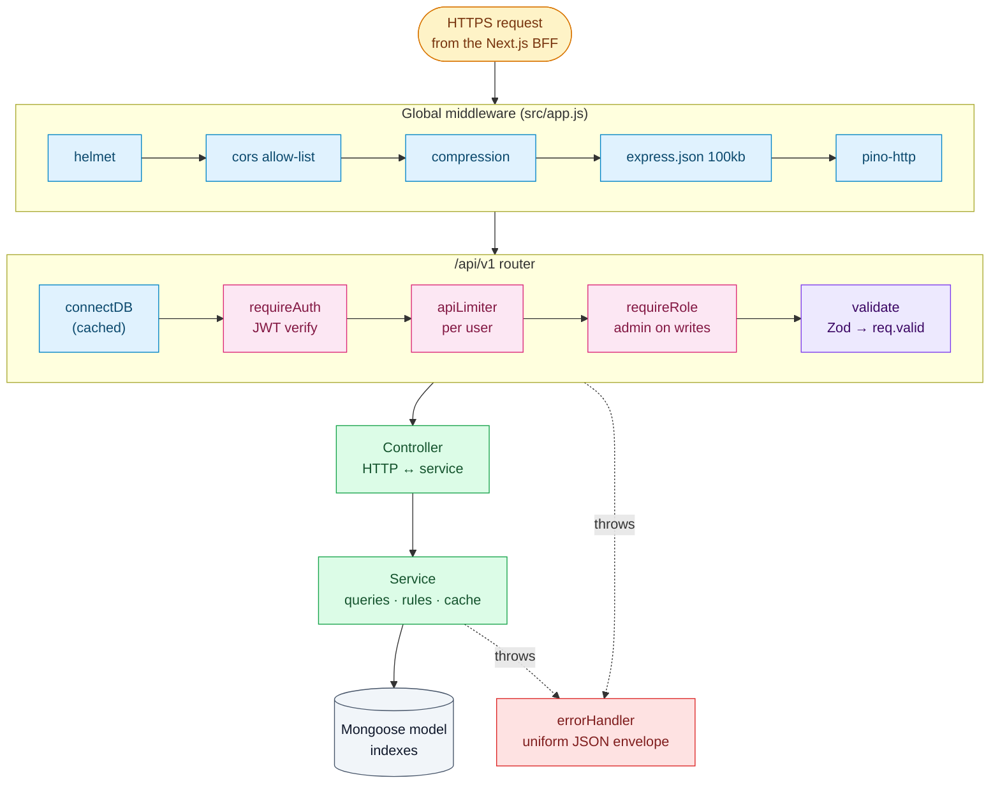
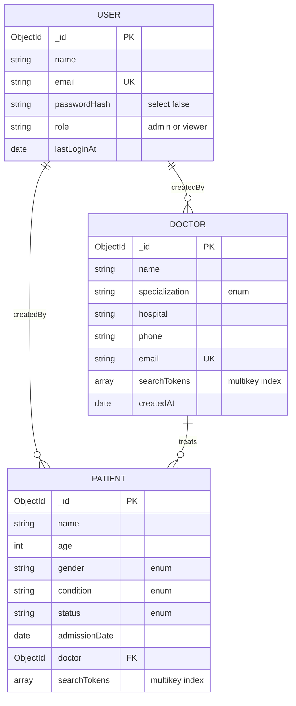
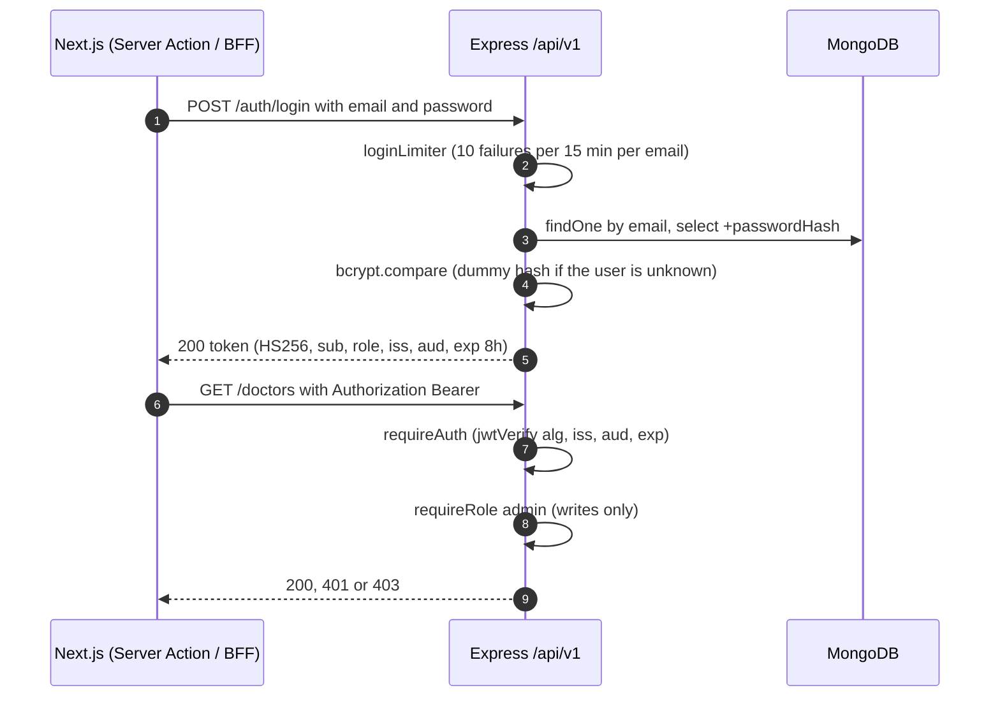

<div align="center">

# 🩺 Doctor Tracker — Backend Runbook

### 📗 Part 2 of 2 · Express 5 REST API · MongoDB 8 · Hostinger KVM 4 VPS

<br/>


📘 **Companion runbook:** [`D:\projects\doctor-tracker\RUNBOOK.md`](../doctor-tracker/RUNBOOK.md) — frontend, master plan, hosting & submission

| 🎯 [Mission](#mission) | 🏗️ [Architecture](#architecture) | 📜 [API contract](#contract) | 🛠️ [Build B0→B8](#b0) | 🚀 [Deploy](#b9) | 📝 [README](#b10) | 🧯 [Troubleshooting](#troubleshooting) |
| :---: | :---: | :---: | :---: | :---: | :---: | :---: |

</div>

---

> [!TIP]
> **How to use this file.** Work top to bottom. Each phase has a goal, copy-ready snippets (expand the ▶ blocks) and a ✅ **Definition of Done**. Diagrams render on GitHub, or in VS Code with the *Markdown Preview Mermaid Support* extension.

> [!IMPORTANT]
> The installed versions are newer than most tutorials, and every snippet here was **run against them**:
> **Express 5.3** (async errors are forwarded automatically · `req.query` is a read-only getter · the default query parser is `simple`) ·
> **Mongoose 9.11** (pre-hooks are `async` with **no `next()`** · no `background` index option) ·
> **Zod 4.6** (`z.email()` checks *before* trimming · `.partial()` keeps defaults · `z.flattenError()`).

---

## 📑 Table of contents

| # | Section | # | Section |
| --- | --- | --- | --- |
| 0 | [🎯 Mission briefing](#mission) | 8 | [🧑‍🤝‍🧑 B6 · Patients API](#b6) |
| 1 | [🏗️ Architecture](#architecture) | 9 | [📊 B7 · Analytics API](#b7) |
| 2 | [📜 API contract (source of truth)](#contract) | 10 | [🛡️ B8 · Hardening, docs, tests, `explain()` proof](#b8) |
| 3 | [🧰 B0 · MongoDB Atlas (development DB)](#b0) | 11 | [🚀 B9 · Hostinger VPS deploy + MongoDB migration](#b9) |
| 4 | [🟦 B1 · Foundation](#b1) | 12 | [📝 B10 · Backend README](#b10) |
| 5 | [🟩 B2 · Data model & indexes](#b2) | 13 | [🧯 Troubleshooting](#troubleshooting) |
| 6 | [🌱 B3 · Seed data & index sync](#b3) | 14 | [📚 Reference](#reference) |
| 7 | [🔐 B4 · Auth & RBAC](#b4) · [👨‍⚕️ B5 · Doctors API](#b5) | | |

---

<a id="mission"></a>

## 🎯 0. Mission briefing

### 0.1 Scope of this repo

A **standalone Express 5 REST API** (the spec's updated tech stack) that the Next.js frontend consumes over HTTPS. It owns:

| Responsibility | Delivered by |
| --- | --- |
| 🔐 Authentication & authorization | bcrypt + JWT (jose) · `requireAuth` · `requireRole('admin')` · login rate limiting |
| 👨‍⚕️ Doctors | Create · get · list with search / filters / sort / pagination · patients per doctor |
| 🧑‍🤝‍🧑 Patients | Add under a doctor · list with rich filters · edit (incl. reassignment) · delete |
| 📊 Analytics | One `/analytics/overview` endpoint with index-backed aggregations, timezone-aware buckets and a 60 s cache |
| ✅ Quality | Zod validation on every input · uniform error envelope · structured logs · Swagger docs · tests |

### 0.2 Guiding principles

1. 📜 **Contract first.** The [API contract](#contract) is the agreement with the frontend. Change it there first.
2. 🧅 **Thin routes, thin controllers, fat services.** Routes wire middleware; controllers translate HTTP; services hold the logic and queries.
3. 🚧 **Validate at the edge.** Zod parses `params` / `query` / `body` before any controller runs, and handlers read only `req.valid`.
4. 📇 **Index everything you filter or sort by**, following **E**quality → **S**ort → **R**ange (ESR), and prove it with `explain()`.
5. 🧊 **Stateless.** JWT Bearer auth, so the API can scale horizontally and is easy to test with Swagger or curl.

### 0.3 ✅ Already done for you (21 Oct)

| Item | State |
| --- | --- |
| `git init -b main` | ✅ Repo on `main` · `.gitignore` covers `node_modules`, `.env*` (keeps `.env.example`), logs, coverage |
| `package.json` | ✅ ESM (`"type": "module"`), Node `24.x`, scripts `dev` / `start` / `seed` / `db:indexes` / `lint` / `format` / `test` |
| Dependencies | ✅ Installed. No `dotenv` or `nodemon`: Node 24's built-in `--env-file-if-exists` and `--watch` replace them |
| Install-script policy | ✅ `allowScripts`: `@scarf/scarf` **denied** (telemetry pulled in by swagger-ui) · `mongodb-memory-server` approved, with its large binary download deferred until the first test run |

<details>
<summary>📦 <b>Installed packages and what each is for</b></summary>

| Package | Version | Purpose |
| --- | --- | --- |
| `express` | 5.3 | HTTP framework (native async error handling) |
| `mongoose` | 9.11 | ODM, schema validation, indexes |
| `zod` | 4.6 | Request + environment validation |
| `jose` | 6.2 | Sign/verify JWT (same library as the frontend) |
| `bcryptjs` | 3.0 | Password hashing, pure JS (no native build step on the server) |
| `helmet` · `cors` · `compression` · `express-rate-limit` | 8.3 · 2.8 · 1.8 · 8.7 | Security headers · origin allow-list · gzip · throttling |
| `pino` · `pino-http` (+ `pino-pretty` dev) | 10 · 11 · 13 | Fast structured logging |
| `swagger-ui-express` | 5.0 | Interactive docs at `/api/docs` |
| `@faker-js/faker` *(dev)* | 10.6 | Realistic seed data |
| `vitest` · `supertest` · `mongodb-memory-server` *(dev)* | 5.0 · 7.3 · 11.3 | API integration tests against an in-memory MongoDB |
| `eslint` · `@eslint/js` · `globals` · `prettier` *(dev)* | 10.13 · 10.0 · 17 · 3.9 | Lint + format |

</details>

### 0.4 Timeline (backend slice of the 48-hour plan)

| Block | Phases | Budget |
| --- | --- | --- |
| 🌙 Wed evening | B0 Atlas → B1 foundation → B2 models → B3 seed → B4 auth → **VPS baseline + first API deploy** | ~6 h |
| ☀️ Thu morning | B5 doctors → B6 patients → B7 analytics → B8 hardening → redeploy | ~4 h |
| 🌅 Fri morning | Atlas → VPS data migration (B9) · B10 README with `explain()` evidence + Swagger screenshot | ~1 h |

> [!TIP]
> **Deploy a walking skeleton early** (right after B4). Discovering hosting problems on Wednesday night is cheap; discovering them on Friday morning is not.

---

<a id="architecture"></a>

## 🏗️ 1. Architecture

### 1.1 Request lifecycle



### 1.2 Folder structure (feature modules)

```text
doctor-tracker-backend/
├── src/
│   ├── app.js                    # builds the Express app (no listen) → used by server.js and the tests
│   ├── server.js                 # connect DB → listen → graceful shutdown
│   ├── config/
│   │   ├── env.js                # Zod-validated environment (fail fast on boot)
│   │   ├── db.js                 # cached mongoose connection
│   │   └── logger.js             # pino (pretty in dev, JSON in prod)
│   ├── constants/enums.js        # ROLES · SPECIALIZATIONS · CONDITIONS · STATUSES · GENDERS
│   ├── middlewares/              # auth · validate · rate-limit · not-found · error-handler
│   ├── modules/
│   │   ├── auth/                 # user.model · auth.schemas · auth.service · auth.controller · auth.routes
│   │   ├── doctors/              # doctor.model · doctors.schemas · doctors.service · doctors.controller · doctors.routes
│   │   ├── patients/             # patient.model · patients.schemas · patients.service · patients.controller · patients.routes
│   │   ├── analytics/            # analytics.service · analytics.controller · analytics.routes
│   │   └── meta/                 # meta.service · meta.routes (filter options)
│   ├── routes/index.js           # mounts every module under /api/v1
│   ├── docs/openapi.js           # OpenAPI 3.1 spec for Swagger UI
│   └── utils/                    # api-error · zod · search · pagination · date-range · periods · cache · serialize · mongoose-json
├── scripts/
│   ├── seed.js                   # demo users + 48 doctors + 1,500 patients (deterministic)
│   ├── sync-indexes.js           # create/drop indexes to match the schemas
│   └── explain.js                # prints the query plan for key queries (README evidence)
├── tests/                        # setup.js · auth.test.js · doctors.test.js
├── .env.example · eslint.config.js · .prettierrc · vitest.config.js · ecosystem.config.cjs (PM2)
└── README.md
```

---

<a id="contract"></a>

## 📜 2. API contract (source of truth)

### 2.1 Conventions

| Topic | Rule |
| --- | --- |
| Base URL | `/api/v1` · JSON only · UTF-8 |
| Auth | `Authorization: Bearer <JWT>` on everything except `GET /health` and `POST /auth/login` |
| IDs | Exposed as `id` (24-hex string), never `_id` |
| Dates | ISO 8601 in UTC. Filters accept ISO date-times; the frontend sends the user's local day bounds |
| Pagination | `page` (≥ 1, default 1) · `limit` (1–100, default 10) |
| Unknown query keys | Stripped by Zod (never reach MongoDB) |

```jsonc
// ✅ success (single)
{ "success": true, "data": { "id": "66f1…", "name": "Dr. Ayesha Rahman" } }

// ✅ success (list)
{ "success": true, "data": [ /* … */ ],
  "meta": { "page": 2, "limit": 10, "total": 312, "totalPages": 32, "hasNextPage": true, "hasPrevPage": true } }

// ❌ error
{ "success": false,
  "error": { "code": "VALIDATION_ERROR", "message": "Request validation failed",
             "details": { "formErrors": [], "fieldErrors": { "email": ["Enter a valid email address"] } } } }
```

| HTTP | `error.code` | When |
| --- | --- | --- |
| 200 / 201 / 204 | — | Read & update / created (+ `Location` header) / deleted |
| 400 | `BAD_REQUEST` | Malformed JSON, invalid id, missing referenced doctor |
| 401 | `UNAUTHORIZED` | Missing, expired or invalid token · wrong credentials |
| 403 | `FORBIDDEN` | Authenticated, but the role isn't allowed (viewer writing) |
| 404 | `NOT_FOUND` | Unknown route or resource |
| 409 | `CONFLICT` | Duplicate unique field (doctor email) |
| 413 | `PAYLOAD_TOO_LARGE` | Body > 100 kb |
| 422 | `VALIDATION_ERROR` | Zod / Mongoose validation failed (`details.fieldErrors`) |
| 429 | `RATE_LIMITED` | Too many login attempts or API calls |
| 500 | `INTERNAL_ERROR` | Bug — logged with the stack; the stack is only returned outside production |

### 2.2 Endpoints

| Method | Path | Auth | Role | Purpose | Priority |
| --- | --- | --- | --- | --- | --- |
| `GET` | `/health` | — | — | Liveness (uptime monitor, deploy checks) |  |
| `POST` | `/auth/login` | — | — | Email + password → JWT (rate-limited) |  |
| `GET` | `/auth/me` | ✅ | any | Current user |  |
| `GET` | `/doctors` | ✅ | any | List · search · filter · sort · paginate |  |
| `POST` | `/doctors` | ✅ | admin | Create a doctor |  |
| `GET` | `/doctors/:id` | ✅ | any | Doctor profile + `patientCount` |  |
| `PATCH` | `/doctors/:id` | ✅ | admin | Edit a doctor |  |
| `GET` | `/doctors/:id/patients` | ✅ | any | Patients of one doctor (same filters as `/patients`) |  |
| `POST` | `/doctors/:id/patients` | ✅ | admin | Add a patient under this doctor |  |
| `DELETE` | `/doctors/:id/patients/:patientId` | ✅ | admin | Remove (delete) a patient from the doctor's list |  |
| `GET` | `/patients` | ✅ | any | List · search · filter · sort · paginate |  |
| `GET` | `/patients/:id` | ✅ | any | Patient detail (doctor populated) |  |
| `PATCH` | `/patients/:id` | ✅ | admin | Partial update (incl. `doctor` reassignment) |  |
| `DELETE` | `/patients/:id` | ✅ | admin | Delete a patient |  |
| `GET` | `/analytics/overview?range=` | ✅ | any | Dashboard aggregates |  |
| `GET` | `/meta/options` | ✅ | any | Enums + hospitals + doctor options for selects |  |
| `GET` | `/api/docs` *(outside v1)* | — | — | Swagger UI |  |

### 2.3 Query parameters

| Endpoint | Parameter | Type / values | Notes |
| --- | --- | --- | --- |
| `/doctors` | `search` | string ≤ 100 | Prefix match on name, specialization, hospital, email words |
| | `specialization` | enum | See `SPECIALIZATIONS` |
| | `hospital` | string | Exact match (values come from `/meta/options`) |
| | `from`, `to` | ISO date/time | Range on `createdAt` (registration date) |
| | `sort` | `newest` · `oldest` · `name_asc` · `name_desc` | Default `newest` |
| `/patients` and `/doctors/:id/patients` | `search` | string ≤ 100 | Name, condition, email, phone digits |
| | `condition` · `status` · `gender` | enums | Single value each |
| | `doctor` | ObjectId | Ignored on the nested route |
| | `minAge`, `maxAge` | 0–120 | Inclusive |
| | `from`, `to` | ISO date/time | Range on `admissionDate` |
| | `sort` | `newest` · `oldest` · `name_asc` · `name_desc` · `age_asc` · `age_desc` | Default `newest` |
| `/analytics/overview` | `range` | `7d` · `30d` · `90d` · `12m` · `all` | Default `12m` · daily buckets for ≤ 31 days, monthly otherwise |

### 2.4 Payload examples

<details>
<summary>🔑 <b>POST /auth/login</b></summary>

```jsonc
// request
{ "email": "admin@doctortracker.test", "password": "Admin@12345" }

// 200
{ "success": true,
  "data": { "token": "eyJhbGciOiJIUzI1NiIsInR5cCI6IkpXVCJ9…",
            "expiresAt": "2026-10-22T02:15:00.000Z",
            "user": { "id": "66f1…", "name": "Demo Admin", "email": "admin@doctortracker.test", "role": "admin" } } }

// 401 → { "success": false, "error": { "code": "UNAUTHORIZED", "message": "Invalid email or password" } }
```

</details>

<details>
<summary>👨‍⚕️ <b>Doctor</b> · 🧑 <b>Patient</b> objects</summary>

```jsonc
// Doctor (list item / profile)
{ "id": "66f1c2a9b3e4d5f6a7b8c9d0", "name": "Dr. Ayesha Rahman", "specialization": "Cardiology",
  "hospital": "Riverside Heart Institute", "phone": "+880 1711-000000",
  "email": "ayesha.rahman@doctortracker.test", "patientCount": 31,
  "createdAt": "2026-03-14T09:12:00.000Z", "updatedAt": "2026-03-14T09:12:00.000Z" }

// Patient (list item / detail)
{ "id": "66f2…", "name": "Rahim Uddin", "age": 54, "gender": "male", "phone": "+880 1812-345678",
  "email": "rahim.uddin@example.com", "condition": "Hypertension", "status": "under_observation",
  "admissionDate": "2026-09-02T04:30:00.000Z", "notes": "BP monitoring twice daily",
  "doctor": { "id": "66f1…", "name": "Dr. Ayesha Rahman", "specialization": "Cardiology" },
  "createdAt": "2026-09-02T04:30:00.000Z", "updatedAt": "2026-09-05T10:00:00.000Z" }
```

</details>

<details>
<summary>📊 <b>GET /analytics/overview?range=30d</b></summary>

```jsonc
{ "success": true,
  "data": {
    "range": { "key": "30d", "from": "2026-09-21T12:00:00.000Z", "to": "2026-10-21T12:00:00.000Z", "unit": "day" },
    "totals": { "doctors": 48, "patients": 1500, "critical": 118, "newPatients": 164,
                "newPatientsChangePct": 12.4, "avgPatientsPerDoctor": 31.3 },
    "patientsOverTime": [ { "period": "2026-09-21", "count": 4 }, { "period": "2026-09-22", "count": 7 } ],
    "patientsPerDoctor": [ { "doctorId": "66f1…", "name": "Dr. Ayesha Rahman", "specialization": "Cardiology", "count": 19 } ],
    "byCondition": [ { "condition": "Hypertension", "count": 31 } ],
    "byStatus": [ { "status": "stable", "count": 80 } ],
    "doctorsBySpecialization": [ { "specialization": "Cardiology", "count": 4 } ] } }
```

</details>

---

<a id="b0"></a>

## 🧰 3. Phase B0 — MongoDB Atlas (development database)

> ⏱️ **30 min** · 🎯 **Outcome:** a free Atlas cluster for development, a least-privilege DB user and working connection strings. **Production MongoDB runs on the VPS** ([B9](#b9)); the Atlas data is migrated there with `mongodump` / `mongorestore`.

| Step | Action |
| --- | --- |
| 1 | **cloud.mongodb.com** → create project **Doctor Tracker** |
| 2 | **Create cluster → Free** · provider AWS · region **closest to you** (e.g. *Singapore / ap-southeast-1* for South Asia) · name `dt-cluster` |
| 3 | **Database Access → Add user** `dt_app` · auto-generated password (alphanumeric avoids URL-encoding trouble) · role *Read and write to any database* (or, least-privilege, `readWrite` on `doctor_tracker` and `doctor_tracker_dev`) |
| 4 | **Network Access → Add IP** → your current IP **and the VPS IP** (needed for the migration in B9), or `0.0.0.0/0` for simplicity during development (compensate with the strong password and limited role) |
| 5 | **Connect → Drivers → Node.js** → copy the `mongodb+srv://…` string |
| 6 | Insert the **database name** before the `?`: `…mongodb.net/doctor_tracker_dev?retryWrites=true&w=majority&appName=dt-cluster` (dev) and `…/doctor_tracker?…` (the dataset you'll migrate to the VPS) |

> [!NOTE]
> **Free-cluster facts worth knowing:** shared tier (512 MB storage), max 500 connections, **one** free cluster per project, no backups, aggregation pipelines ≤ 50 stages (ours use ≤ 7), and `allowDiskUse` is ignored, so **unindexed large sorts fail**. That is one more reason to index every sort. Atlas may pause long-idle free clusters.

### ✅ Definition of Done — B0

- [ ] Cluster is green · user created · your IP (and later the VPS IP) allowed
- [ ] Two connection strings saved in your password manager (`_dev` and prod DB names)

---

<a id="b1"></a>

## 🟦 4. Phase B1 — Foundation

> ⏱️ **60 min** · 🎯 **Outcome:** the server boots, validates its environment, connects to Atlas, logs every request, and answers `/api/v1/health`. Errors come back in one consistent shape.

### Step B1.1 · Environment

```powershell
# Generate the shared JWT secret ONCE and paste it into backend .env AND frontend .env.local
node -e "console.log(require('crypto').randomBytes(48).toString('base64url'))"
```

<details>
<summary>📄 <b>.env.example</b> (commit this) — copy to <code>.env</code> and fill in</summary>

```dotenv
# ── Server ───────────────────────────────────────────────
NODE_ENV=development
# 127.0.0.1 on the VPS, so only Nginx is reachable from the internet
HOST=0.0.0.0
PORT=4000
LOG_LEVEL=debug

# ── Database (MongoDB Atlas) — use a different DB name per environment ──
MONGODB_URI=mongodb+srv://<user>:<password>@<cluster>.mongodb.net/doctor_tracker_dev?retryWrites=true&w=majority&appName=dt-cluster

# ── Auth — JWT_* must match the frontend's values exactly ──
JWT_SECRET=replace-with-a-48-byte-random-secret
JWT_EXPIRES_IN=8h
JWT_ISSUER=doctor-tracker-api
JWT_AUDIENCE=doctor-tracker-web
BCRYPT_ROUNDS=10

# ── HTTP — comma-separated browser origins allowed by CORS ──
CORS_ORIGINS=http://localhost:3000

# ── Analytics — timezone used to bucket dates on the dashboard ──
APP_TIMEZONE=Asia/Dhaka
```

</details>

<details>
<summary>📄 <b>src/config/env.js</b> — fail fast with a readable error</summary>

```js
import { z } from 'zod';

const EnvSchema = z.object({
  NODE_ENV: z.enum(['development', 'test', 'production']).default('development'),
  HOST: z.string().default('0.0.0.0'),
  PORT: z.coerce.number().int().positive().default(4000),
  LOG_LEVEL: z.enum(['fatal', 'error', 'warn', 'info', 'debug', 'trace', 'silent']).default('info'),
  MONGODB_URI: z.string().min(1, 'MONGODB_URI is required'),
  JWT_SECRET: z.string().min(32, 'JWT_SECRET must be at least 32 characters'),
  JWT_EXPIRES_IN: z.string().default('8h'),
  JWT_ISSUER: z.string().default('doctor-tracker-api'),
  JWT_AUDIENCE: z.string().default('doctor-tracker-web'),
  BCRYPT_ROUNDS: z.coerce.number().int().min(8).max(14).default(10),
  CORS_ORIGINS: z.string().default('http://localhost:3000'),
  APP_TIMEZONE: z.string().default('Asia/Dhaka'),
});

const parsed = EnvSchema.safeParse(process.env);
if (!parsed.success) {
  console.error(`❌ Invalid environment variables:\n${z.prettifyError(parsed.error)}`);
  process.exit(1);
}

export const env = Object.freeze({
  ...parsed.data,
  corsOrigins: parsed.data.CORS_ORIGINS.split(',').map((origin) => origin.trim()).filter(Boolean),
  isProduction: parsed.data.NODE_ENV === 'production',
});
```

</details>

> [!NOTE]
> `bcryptjs` is pure JavaScript, so the cost factor matters. Use `BCRYPT_ROUNDS=10` on laptops and small shared CPUs, and `12` on the 4-vCPU VPS. Both are within OWASP guidance for bcrypt, and existing hashes keep working when you change it (the cost is stored inside each hash).

### Step B1.2 · Logger & database

<details>
<summary>📄 <b>src/config/logger.js</b> · <b>src/config/db.js</b></summary>

```js
// src/config/logger.js
import pino from 'pino';
import { env } from './env.js';

export const logger = pino({
  level: env.LOG_LEVEL,
  redact: ['req.headers.authorization', 'req.headers.cookie', '*.password', '*.passwordHash'],
  ...(env.NODE_ENV === 'development' && {
    transport: {
      target: 'pino-pretty',
      options: { colorize: true, translateTime: 'SYS:HH:MM:ss', ignore: 'pid,hostname' },
    },
  }),
});
```

```js
// src/config/db.js
import mongoose from 'mongoose';
import { env } from './env.js';
import { logger } from './logger.js';

mongoose.set('strictQuery', true); // unknown filter keys are dropped, never sent to MongoDB

let connecting = null;

/** Idempotent: returns the live connection, or a single in-flight connect promise. */
export function connectDB() {
  if (mongoose.connection.readyState === 1) return Promise.resolve(mongoose.connection);
  connecting ??= mongoose
    .connect(env.MONGODB_URI, {
      maxPoolSize: 10,
      serverSelectionTimeoutMS: 10_000,
      autoIndex: !env.isProduction, // prod indexes are created explicitly: npm run db:indexes
    })
    .then(({ connection }) => {
      logger.info({ db: connection.name }, 'MongoDB connected');
      return connection;
    })
    .catch((error) => {
      connecting = null; // allow a retry on the next request
      throw error;
    });
  return connecting;
}

export async function disconnectDB() {
  await mongoose.disconnect();
  connecting = null;
}
```

</details>

### Step B1.3 · Errors, validation, 404

<details>
<summary>📄 <b>src/utils/api-error.js</b> · <b>src/middlewares/validate.js</b> · <b>not-found.js</b></summary>

```js
// src/utils/api-error.js
export class ApiError extends Error {
  constructor(status, code, message, details) {
    super(message);
    this.status = status;
    this.code = code;
    this.details = details;
  }
  static badRequest(message, details) { return new ApiError(400, 'BAD_REQUEST', message, details); }
  static unauthorized(message = 'Authentication required') { return new ApiError(401, 'UNAUTHORIZED', message); }
  static forbidden(message = 'You do not have permission to perform this action') { return new ApiError(403, 'FORBIDDEN', message); }
  static notFound(entity = 'Resource') { return new ApiError(404, 'NOT_FOUND', `${entity} not found`); }
  static conflict(message, details) { return new ApiError(409, 'CONFLICT', message, details); }
}
```

```js
// src/middlewares/validate.js
/**
 * Parses params/query/body with Zod and stores the typed result on req.valid.
 * Express 5: req.query is a read-only getter, so never reassign it.
 */
export const validate = (schemas) => (req, _res, next) => {
  const valid = {};
  for (const key of ['params', 'query', 'body']) {
    if (!schemas[key]) continue;
    const result = schemas[key].safeParse(req[key] ?? {});
    if (!result.success) return next(result.error); // ZodError → 422 in errorHandler
    valid[key] = result.data;
  }
  req.valid = valid;
  next();
};
```

```js
// src/middlewares/not-found.js
import { ApiError } from '../utils/api-error.js';

export function notFound(req, _res, next) {
  next(ApiError.notFound(`Route ${req.method} ${req.originalUrl}`));
}
```

</details>

<details>
<summary>📄 <b>src/middlewares/error-handler.js</b> — one place that shapes every error</summary>

```js
import mongoose from 'mongoose';
import { z } from 'zod';
import { errors as joseErrors } from 'jose';
import { env } from '../config/env.js';
import { ApiError } from '../utils/api-error.js';

// Express recognises error handlers by their 4 parameters, so `_next` must stay even though it's unused
export function errorHandler(err, req, res, _next) {
  let status = 500;
  let code = 'INTERNAL_ERROR';
  let message = 'Something went wrong';
  let details;

  if (err instanceof ApiError) {
    ({ status, code, message, details } = err);
  } else if (err instanceof z.ZodError) {
    status = 422; code = 'VALIDATION_ERROR'; message = 'Request validation failed';
    details = z.flattenError(err);
  } else if (err instanceof mongoose.Error.ValidationError) {
    status = 422; code = 'VALIDATION_ERROR'; message = 'Validation failed';
    details = { formErrors: [], fieldErrors: Object.fromEntries(Object.entries(err.errors).map(([k, v]) => [k, [v.message]])) };
  } else if (err instanceof mongoose.Error.CastError) {
    status = 400; code = 'BAD_REQUEST'; message = `Invalid ${err.path}`;
  } else if (err?.code === 11000) {
    const field = Object.keys(err.keyPattern ?? {})[0] ?? 'field';
    status = 409; code = 'CONFLICT'; message = `A record with this ${field} already exists`;
    details = { formErrors: [], fieldErrors: { [field]: [message] } };
  } else if (err instanceof joseErrors.JOSEError) {
    status = 401; code = 'UNAUTHORIZED'; message = 'Invalid or expired token';
  } else if (err?.type === 'entity.parse.failed') {
    status = 400; code = 'BAD_REQUEST'; message = 'Malformed JSON body';
  } else if (err?.type === 'entity.too.large') {
    status = 413; code = 'PAYLOAD_TOO_LARGE'; message = 'Request body is too large';
  }

  if (status >= 500) req.log?.error({ err }, 'Unhandled error');
  else req.log?.warn({ code, message }, 'Request rejected');

  res.status(status).json({
    success: false,
    error: { code, message, ...(details && { details }), ...(!env.isProduction && status >= 500 && { stack: err.stack }) },
  });
}
```

</details>

### Step B1.4 · App & server

<details>
<summary>📄 <b>src/app.js</b></summary>

```js
import express from 'express';
import helmet from 'helmet';
import cors from 'cors';
import compression from 'compression';
import mongoose from 'mongoose';
import { pinoHttp } from 'pino-http';
import swaggerUi from 'swagger-ui-express';
import { env } from './config/env.js';
import { logger } from './config/logger.js';
import { connectDB } from './config/db.js';
import { openapiSpec } from './docs/openapi.js';
import { apiRouter } from './routes/index.js';
import { notFound } from './middlewares/not-found.js';
import { errorHandler } from './middlewares/error-handler.js';

export const app = express();

app.set('trust proxy', 1); // one proxy hop (Nginx on the VPS) → correct req.ip and protocol
app.disable('x-powered-by');

// Interactive docs first: Swagger UI needs a relaxed CSP, everything else gets the strict default
app.use('/api/docs', helmet({ contentSecurityPolicy: false }), swaggerUi.serve, swaggerUi.setup(openapiSpec, { customSiteTitle: 'Doctor Tracker API' }));

app.use(helmet());
app.use(cors({ origin: env.corsOrigins, methods: ['GET', 'POST', 'PATCH', 'DELETE'], allowedHeaders: ['Content-Type', 'Authorization'], maxAge: 600 }));
app.use(compression());
app.use(express.json({ limit: '100kb' }));
app.use(pinoHttp({ logger, autoLogging: { ignore: (req) => req.url === '/api/v1/health' } }));

app.get('/api/v1/health', (_req, res) => {
  res.json({
    success: true,
    data: { status: 'ok', db: mongoose.connection.readyState === 1 ? 'up' : 'down', uptime: Math.round(process.uptime()), timestamp: new Date().toISOString() },
  });
});

// Lazy + cached DB connection: a no-op once connected; keeps app.js self-sufficient for tests
app.use('/api/v1', async (_req, _res, next) => { await connectDB(); next(); }, apiRouter);

app.use(notFound);
app.use(errorHandler);

export default app;
```

</details>

<details>
<summary>📄 <b>src/server.js</b> — fail fast, shut down gracefully</summary>

```js
import { app } from './app.js';
import { env } from './config/env.js';
import { logger } from './config/logger.js';
import { connectDB, disconnectDB } from './config/db.js';

await connectDB(); // top-level await (ESM): crash early if Atlas is unreachable

// HOST=127.0.0.1 on the VPS → reachable only through Nginx
const server = app.listen(env.PORT, env.HOST, () => {
  logger.info(`🚀 API ready on http://${env.HOST}:${env.PORT}/api/v1 · docs at /api/docs`);
});

function shutdown(signal) {
  logger.info({ signal }, 'Shutting down gracefully');
  server.close(async () => {
    await disconnectDB();
    process.exit(0);
  });
  setTimeout(() => process.exit(1), 10_000).unref(); // hard stop if connections hang
}

process.on('SIGTERM', shutdown); // systemd / pm2 kill
process.on('SIGINT', shutdown); // PM2's default signal on restart/reload
process.on('unhandledRejection', (reason) => {
  logger.fatal({ reason }, 'Unhandled promise rejection');
  shutdown('unhandledRejection');
});
```

</details>

<details>
<summary>📄 <b>src/routes/index.js</b></summary>

```js
import { Router } from 'express';
import { requireAuth } from '../middlewares/auth.js';
import { apiLimiter } from '../middlewares/rate-limit.js';
import { authRouter } from '../modules/auth/auth.routes.js';
import { doctorsRouter } from '../modules/doctors/doctors.routes.js';
import { patientsRouter } from '../modules/patients/patients.routes.js';
import { analyticsRouter } from '../modules/analytics/analytics.routes.js';
import { metaRouter } from '../modules/meta/meta.routes.js';

export const apiRouter = Router();

apiRouter.use('/auth', authRouter); // /auth/login is public; /auth/me checks auth itself

apiRouter.use(requireAuth, apiLimiter); // ⬇ everything below needs a valid token
apiRouter.use('/doctors', doctorsRouter);
apiRouter.use('/patients', patientsRouter);
apiRouter.use('/analytics', analyticsRouter);
apiRouter.use('/meta', metaRouter);
```

</details>

### Step B1.5 · Lint & format config

<details>
<summary>📄 <b>eslint.config.js</b> (ESLint 10 flat config) · <b>.prettierrc</b></summary>

```js
// eslint.config.js
import js from '@eslint/js';
import globals from 'globals';
import { defineConfig } from 'eslint/config';

export default defineConfig([
  { ignores: ['node_modules', 'coverage'] },
  {
    files: ['**/*.js'],
    extends: [js.configs.recommended],
    languageOptions: { ecmaVersion: 'latest', sourceType: 'module', globals: { ...globals.node } },
    rules: {
      'no-unused-vars': ['error', { argsIgnorePattern: '^_', ignoreRestSiblings: true }],
      'prefer-const': 'error',
      eqeqeq: ['error', 'smart'],
    },
  },
]);
```

```json
{ "singleQuote": true, "semi": true, "printWidth": 100, "trailingComma": "all" }
```

</details>

### ✅ Definition of Done — B1

- [ ] `npm run dev` → logs `MongoDB connected {"db":"doctor_tracker_dev"}` and `🚀 API ready…`
- [ ] `curl http://localhost:4000/api/v1/health` → `{"success":true,"data":{"status":"ok","db":"up",…}}`
- [ ] `curl.exe http://localhost:4000/api/v1/nope` → `401` (everything under `/api/v1` except login is protected) · `curl.exe -X POST http://localhost:4000/api/v1/auth/login -H "Content-Type: application/json" -d "{bad json"` → `400 BAD_REQUEST`
- [ ] Deleting `JWT_SECRET` from `.env` → boot fails with a readable Zod message
- [ ] `npm run lint` is clean

---

<a id="b2"></a>

## 🟩 5. Phase B2 — Data model & indexes

> ⏱️ **60 min** · 🎯 **Outcome:** three collections with validation, safe JSON output, search tokens and an index for every query the frontend makes.



### Step B2.1 · Enums

<details>
<summary>📄 <b>src/constants/enums.js</b> (mirror these in the frontend's <code>src/lib/constants.js</code>)</summary>

```js
export const ROLES = ['admin', 'viewer'];

export const SPECIALIZATIONS = [
  'Cardiology', 'Dermatology', 'Endocrinology', 'ENT', 'Gastroenterology',
  'General Medicine', 'Gynecology', 'Neurology', 'Oncology', 'Ophthalmology',
  'Orthopedics', 'Pediatrics', 'Psychiatry', 'Pulmonology', 'Urology',
];

export const CONDITIONS = [
  'Hypertension', 'Diabetes', 'Asthma', 'Heart Disease', 'Arthritis', 'Migraine', 'Fracture',
  'Skin Allergy', 'Anxiety', 'Thyroid Disorder', 'Kidney Disease', 'Respiratory Infection', 'Other',
];

export const STATUSES = ['stable', 'under_observation', 'critical', 'recovered'];
export const GENDERS = ['male', 'female', 'other'];
```

</details>

### Step B2.2 · Search strategy — index-backed prefix search

| Option | Partial words ("card" → *Cardiology*) | Uses an index | Verdict |
| --- | --- | --- | --- |
| `$regex: /card/i` on each field | ✅ | ❌ case-insensitive regex can't use an index efficiently → scans | 🚫 doesn't scale |
| `$text` index | ❌ whole words only (stemming) | ✅ | 😐 poor search-as-you-type UX |
| Atlas Search (`autocomplete`) | ✅ fuzzy + relevance | ✅ (Lucene) | ⭐ best at scale, but extra infrastructure → *future work* |
| **Search tokens** (lower-cased words in an array + multikey index, anchored `^prefix` regex) | ✅ | ✅ `IXSCAN` on `searchTokens_1` | ✅ **chosen**: simple, fast, explainable |

<details>
<summary>📄 <b>src/utils/search.js</b> (unit-checked: accents folded, emails and phone digits matched, regex characters escaped)</summary>

```js
const DIACRITICS = /[\u0300-\u036f]/g;
const normalize = (value) => String(value).toLowerCase().normalize('NFKD').replace(DIACRITICS, '').trim();
const escapeRegex = (value) => value.replace(/[.*+?^${}()|[\]\\]/g, '\\$&');

/** "Dr. Ayesha Rahmán", "ayesha.r@x.test" → ["dr","ayesha","rahman","ayesha.r@x.test","x","test",…] */
export function buildSearchTokens(...values) {
  const tokens = new Set();
  for (const value of values) {
    if (value === undefined || value === null || value === '') continue;
    const text = normalize(value);
    if (text.includes('@')) tokens.add(text); // full email → "ayesha.r@x" prefix-matches
    for (const word of text.split(/[^a-z0-9]+/)) if (word.length >= 2) tokens.add(word);
    const digits = text.replace(/\D/g, '');
    if (digits.length >= 6) tokens.add(digits); // phone numbers
  }
  return [...tokens];
}

/** "dr. ayesha" → { searchTokens: { $all: [/^dr/, /^ayesha/] } } — every term must prefix-match a token */
export function buildSearchFilter(search) {
  const text = search ? normalize(search) : '';
  const terms = (text.includes('@') ? [text] : text.split(/[^a-z0-9]+/)).filter(Boolean).slice(0, 5);
  if (!terms.length) return {};
  return { searchTokens: { $all: terms.map((term) => new RegExp(`^${escapeRegex(term)}`)) } };
}
```

</details>

### Step B2.3 · Shared JSON shaping

<details>
<summary>📄 <b>src/utils/mongoose-json.js</b> · <b>src/utils/serialize.js</b></summary>

```js
// src/utils/mongoose-json.js — applied by doc.toJSON() / res.json(doc)
export const toJSONOptions = {
  virtuals: true, // adds string `id`
  versionKey: false,
  transform: (_doc, ret) => {
    delete ret._id;
    delete ret.searchTokens;
    delete ret.passwordHash;
    delete ret.createdBy;
    return ret;
  },
};
```

```js
// src/utils/serialize.js — lean() results skip toJSON, so shape them explicitly
export function serialize(doc) {
  if (!doc) return doc;
  const { _id, __v, searchTokens, passwordHash, createdBy, doctor, ...rest } = doc;
  return {
    id: String(_id),
    ...rest,
    ...(doctor !== undefined && { doctor: doctor?.name ? serialize(doctor) : String(doctor) }),
  };
}
```

</details>

### Step B2.4 · Models

<details>
<summary>📄 <b>src/modules/auth/user.model.js</b></summary>

```js
import mongoose from 'mongoose';
import { ROLES } from '../../constants/enums.js';
import { toJSONOptions } from '../../utils/mongoose-json.js';

const userSchema = new mongoose.Schema(
  {
    name: { type: String, required: true, trim: true, maxlength: 80 },
    email: { type: String, required: true, unique: true, trim: true, lowercase: true },
    passwordHash: { type: String, required: true, select: false }, // never returned unless asked for
    role: { type: String, enum: ROLES, default: 'admin' },
    lastLoginAt: Date,
  },
  { timestamps: true, toJSON: toJSONOptions },
);

export const User = mongoose.model('User', userSchema);
```

</details>

<details>
<summary>📄 <b>src/modules/doctors/doctor.model.js</b></summary>

```js
import mongoose from 'mongoose';
import { SPECIALIZATIONS } from '../../constants/enums.js';
import { buildSearchTokens } from '../../utils/search.js';
import { toJSONOptions } from '../../utils/mongoose-json.js';

const doctorSchema = new mongoose.Schema(
  {
    name: { type: String, required: true, trim: true, maxlength: 80 },
    specialization: { type: String, required: true, enum: SPECIALIZATIONS },
    hospital: { type: String, required: true, trim: true, maxlength: 120 },
    phone: { type: String, required: true, trim: true, maxlength: 20 },
    email: { type: String, required: true, unique: true, trim: true, lowercase: true, maxlength: 120 },
    searchTokens: { type: [String], select: false },
    createdBy: { type: mongoose.Schema.Types.ObjectId, ref: 'User' },
  },
  { timestamps: true, toJSON: toJSONOptions },
);

export const doctorSearchTokens = (d) => buildSearchTokens(d.name, d.specialization, d.hospital, d.email);

// Mongoose 9: async hook, NO next() parameter
doctorSchema.pre('save', async function () {
  if (this.isNew || ['name', 'specialization', 'hospital', 'email'].some((path) => this.isModified(path))) {
    this.searchTokens = doctorSearchTokens(this);
  }
});

// Indexes — Equality → Sort → Range
doctorSchema.index({ createdAt: -1, _id: -1 }); // default list (newest) + registered-date range
doctorSchema.index({ specialization: 1, createdAt: -1 }); // filter by specialization, newest first
doctorSchema.index({ hospital: 1, createdAt: -1 }); // filter by hospital + distinct('hospital')
doctorSchema.index({ name: 1, _id: 1 }); // name sort
doctorSchema.index({ searchTokens: 1 }); // multikey prefix search

export const Doctor = mongoose.model('Doctor', doctorSchema);
```

</details>

<details>
<summary>📄 <b>src/modules/patients/patient.model.js</b></summary>

```js
import mongoose from 'mongoose';
import { CONDITIONS, GENDERS, STATUSES } from '../../constants/enums.js';
import { buildSearchTokens } from '../../utils/search.js';
import { toJSONOptions } from '../../utils/mongoose-json.js';

const patientSchema = new mongoose.Schema(
  {
    name: { type: String, required: true, trim: true, maxlength: 80 },
    age: { type: Number, required: true, min: 0, max: 120 },
    gender: { type: String, required: true, enum: GENDERS },
    phone: { type: String, trim: true, maxlength: 20 },
    email: { type: String, trim: true, lowercase: true, maxlength: 120 },
    condition: { type: String, required: true, enum: CONDITIONS },
    status: { type: String, required: true, enum: STATUSES, default: 'stable' },
    admissionDate: { type: Date, required: true, default: Date.now },
    notes: { type: String, trim: true, maxlength: 500 },
    doctor: { type: mongoose.Schema.Types.ObjectId, ref: 'Doctor', required: true },
    searchTokens: { type: [String], select: false },
    createdBy: { type: mongoose.Schema.Types.ObjectId, ref: 'User' },
  },
  { timestamps: true, toJSON: toJSONOptions },
);

export const patientSearchTokens = (p) => buildSearchTokens(p.name, p.condition, p.email, p.phone);

patientSchema.pre('save', async function () {
  if (this.isNew || ['name', 'condition', 'email', 'phone'].some((path) => this.isModified(path))) {
    this.searchTokens = patientSearchTokens(this);
  }
});

patientSchema.index({ doctor: 1, admissionDate: -1 }); // a doctor's patients + per-doctor counts
patientSchema.index({ admissionDate: -1, _id: -1 }); // default list, date range, dashboard trend
patientSchema.index({ condition: 1, admissionDate: -1 }); // condition filter
patientSchema.index({ status: 1, admissionDate: -1 }); // status filter + "critical" KPI
patientSchema.index({ searchTokens: 1 }); // multikey prefix search

export const Patient = mongoose.model('Patient', patientSchema);
```

</details>

### Step B2.5 · Index ↔ query map (paste this into the README)

| Query from the UI | Index used | Why it's efficient |
| --- | --- | --- |
| Doctors, newest first, page N | `createdAt_-1__id_-1` | Index order = sort order; `_id` makes the sort stable |
| Doctors by specialization | `specialization_1_createdAt_-1` | **E**quality then **S**ort → no in-memory sort |
| Doctors registered between dates | `createdAt_-1__id_-1` | Range on the sort key |
| Search "card" | `searchTokens_1` | Anchored, case-sensitive prefix regex on lower-cased tokens → index bounds |
| A doctor's patients | `doctor_1_admissionDate_-1` | Equality on doctor + sorted by admission date |
| Patients by condition / status | `condition_1_admissionDate_-1` · `status_1_admissionDate_-1` | ESR |
| Dashboard trend / range KPIs | `admissionDate_-1__id_-1` | `$match` range is index-backed before `$group` |
| Patient counts for a page of doctors | `doctor_1_admissionDate_-1` | `$match: { doctor: { $in: ids } }` → one aggregation for 10 doctors instead of 10 queries |

> [!NOTE]
> **Why not index everything?** Each index costs RAM and slows writes. Gender and age filters run on the already-narrowed result (low selectivity), so they get no dedicated index. That's a deliberate trade-off worth saying out loud in the interview.

### ✅ Definition of Done — B2

- [ ] Creating a doctor stores `searchTokens` (check in Atlas Data Explorer) but never returns it in JSON
- [ ] Atlas → Collections → Indexes shows every index listed above (after B3's sync)

---

<a id="b3"></a>

## 🌱 6. Phase B3 — Seed data & index sync

> ⏱️ **30 min** · 🎯 **Outcome:** deterministic, realistic demo data (2 users · 48 doctors · 1,500 patients over ~18 months) that makes the charts tell a story.

<details>
<summary>📄 <b>scripts/seed.js</b></summary>

```js
// npm run seed            → seeds a *_dev / *_test database
// npm run seed -- --force → required for any other DB name (e.g. production)
import mongoose from 'mongoose';
import bcrypt from 'bcryptjs';
import { faker } from '@faker-js/faker';
import { env } from '../src/config/env.js';
import { connectDB } from '../src/config/db.js';
import { User } from '../src/modules/auth/user.model.js';
import { Doctor, doctorSearchTokens } from '../src/modules/doctors/doctor.model.js';
import { Patient, patientSearchTokens } from '../src/modules/patients/patient.model.js';
import { CONDITIONS, SPECIALIZATIONS } from '../src/constants/enums.js';

const DAY = 86_400_000;
const DOCTOR_COUNT = 48;
const PATIENT_COUNT = 1500;
const HOSPITALS = [
  'Green Valley General Hospital', 'CityCare Medical Center', 'Riverside Heart Institute',
  "Sunrise Children's Hospital", 'Metro Neuro & Spine Center', "Lakeside Women's Clinic",
  'Northgate Diagnostic Hospital', 'Harbor View Medical College',
];
const NOTES = [
  'Follow-up in two weeks', 'BP monitoring twice daily', 'Responding well to medication',
  'Awaiting lab results', 'Diet and exercise counselling given', 'Referred for imaging',
];

faker.seed(2026); // same data on every run → stable screenshots

const conn = await connectDB();
if (!/_(dev|test)$/.test(conn.name) && !process.argv.includes('--force')) {
  console.error(`Refusing to wipe "${conn.name}" without --force`);
  process.exit(1);
}
console.log(`🌱 Seeding "${conn.name}"…`);

await Promise.all([User.deleteMany({}), Doctor.deleteMany({}), Patient.deleteMany({})]);
await Promise.all([User.syncIndexes(), Doctor.syncIndexes(), Patient.syncIndexes()]);

// 1) Demo users (documented in both READMEs)
const [admin] = await User.insertMany([
  { name: 'Demo Admin', email: 'admin@doctortracker.test', role: 'admin', passwordHash: await bcrypt.hash('Admin@12345', env.BCRYPT_ROUNDS) },
  { name: 'Demo Viewer', email: 'viewer@doctortracker.test', role: 'viewer', passwordHash: await bcrypt.hash('Viewer@12345', env.BCRYPT_ROUNDS) },
]);

// 2) Doctors — joined 1–18 months ago (insertMany keeps a supplied createdAt; verified in Mongoose 9)
const now = Date.now();
const doctors = await Doctor.insertMany(
  Array.from({ length: DOCTOR_COUNT }, (_, i) => {
    const firstName = faker.person.firstName();
    const lastName = faker.person.lastName();
    const doc = {
      name: `Dr. ${firstName} ${lastName}`,
      specialization: SPECIALIZATIONS[i % SPECIALIZATIONS.length], // every specialization represented
      hospital: faker.helpers.arrayElement(HOSPITALS),
      phone: faker.phone.number({ style: 'international' }),
      email: `${firstName}.${lastName}.${i}`.toLowerCase().replace(/[^a-z0-9.]/g, '') + '@doctortracker.test',
      createdBy: admin._id,
      createdAt: new Date(now - faker.number.int({ min: 30, max: 540 }) * DAY),
    };
    return { ...doc, searchTokens: doctorSearchTokens(doc) }; // insertMany skips save hooks
  }),
);

// 3) Patients — weighted so the dashboard has a story
const doctorWeights = doctors.map((value, i) => ({ value, weight: 1 + (i % 7) * 2 })); // some doctors are busier
const conditionWeights = CONDITIONS.map((value, i) => ({ value, weight: [18, 16, 9, 10, 7, 6, 5, 6, 7, 6, 4, 8, 3][i] }));
const statusWeights = [
  { value: 'stable', weight: 50 }, { value: 'under_observation', weight: 25 },
  { value: 'critical', weight: 8 }, { value: 'recovered', weight: 17 },
];
const genderWeights = [{ value: 'male', weight: 48 }, { value: 'female', weight: 48 }, { value: 'other', weight: 4 }];

const patients = Array.from({ length: PATIENT_COUNT }, () => {
  const doctor = faker.helpers.weightedArrayElement(doctorWeights);
  const gender = faker.helpers.weightedArrayElement(genderWeights);
  const firstName = faker.person.firstName(gender === 'other' ? undefined : gender);
  const lastName = faker.person.lastName();
  const joined = doctor.createdAt.getTime();
  // sqrt bias → more recent admissions (a growth trend), never before the doctor joined
  const admissionDate = new Date(joined + Math.sqrt(faker.number.float({ min: 0, max: 1 })) * (now - joined));
  const doc = {
    name: `${firstName} ${lastName}`,
    age: faker.number.int({ min: 1, max: 90 }),
    gender,
    phone: faker.phone.number({ style: 'international' }),
    email: faker.datatype.boolean({ probability: 0.7 })
      ? faker.internet.email({ firstName, lastName, provider: 'example.com' }).toLowerCase()
      : undefined,
    condition: faker.helpers.weightedArrayElement(conditionWeights),
    status: faker.helpers.weightedArrayElement(statusWeights),
    admissionDate,
    notes: faker.datatype.boolean({ probability: 0.4 }) ? faker.helpers.arrayElement(NOTES) : undefined,
    doctor: doctor._id,
    createdBy: admin._id,
    createdAt: admissionDate,
  };
  return { ...doc, searchTokens: patientSearchTokens(doc) };
});

for (let i = 0; i < patients.length; i += 500) await Patient.insertMany(patients.slice(i, i + 500));

console.log(`✅ ${doctors.length} doctors · ${patients.length} patients · 2 users`);
console.log('🔑 admin@doctortracker.test / Admin@12345 · viewer@doctortracker.test / Viewer@12345');
await mongoose.disconnect();
```

</details>

<details>
<summary>📄 <b>scripts/sync-indexes.js</b> — <code>npm run db:indexes</code></summary>

```js
import mongoose from 'mongoose';
import { connectDB } from '../src/config/db.js';
import { User } from '../src/modules/auth/user.model.js';
import { Doctor } from '../src/modules/doctors/doctor.model.js';
import { Patient } from '../src/modules/patients/patient.model.js';

await connectDB();
for (const model of [User, Doctor, Patient]) {
  const dropped = await model.syncIndexes(); // creates missing, drops indexes no longer in the schema
  const names = (await model.listIndexes()).map((index) => index.name);
  console.log(`📇 ${model.modelName}: ${names.join(', ')}${dropped.length ? `  (dropped: ${dropped.join(', ')})` : ''}`);
}
await mongoose.disconnect();
```

</details>

> [!IMPORTANT]
> **Why the explicit `searchTokens` in the seed?** `insertMany()` runs validation but **not** `pre('save')` hooks. The API itself always goes through `create()` / `save()`, so the hook keeps tokens in sync on every write.

### ✅ Definition of Done — B3

- [ ] `npm run seed` prints the summary and the demo credentials
- [ ] Atlas shows 48 doctors, 1,500 patients and 2 users · `admissionDate` values spread across ~18 months
- [ ] `npm run db:indexes` lists every index from B2

---

<a id="b4"></a>

## 🔐 7. Phase B4 — Auth & RBAC

> ⏱️ **60 min** · 🎯 **Outcome:** `POST /auth/login` issues a signed JWT, every protected route verifies it, and writes require `admin`.



<details>
<summary>📄 <b>src/middlewares/auth.js</b></summary>

```js
import { jwtVerify } from 'jose';
import { env } from '../config/env.js';
import { ApiError } from '../utils/api-error.js';

const secret = new TextEncoder().encode(env.JWT_SECRET);

export async function requireAuth(req, _res, next) {
  const [scheme, token] = (req.get('authorization') ?? '').split(' ');
  if (scheme !== 'Bearer' || !token) throw ApiError.unauthorized();

  // Throws a JOSEError (expired, bad signature, wrong iss/aud) → 401 via errorHandler
  const { payload } = await jwtVerify(token, secret, {
    algorithms: ['HS256'],
    issuer: env.JWT_ISSUER,
    audience: env.JWT_AUDIENCE,
  });
  req.user = { id: payload.sub, role: payload.role, name: payload.name, email: payload.email };
  next();
}

export const requireRole = (...roles) => (req, _res, next) => {
  if (!roles.includes(req.user?.role)) throw ApiError.forbidden();
  next();
};
```

</details>

<details>
<summary>📄 <b>src/middlewares/rate-limit.js</b> — keyed by account/user, not IP</summary>

```js
import { ipKeyGenerator, MINUTE, rateLimit } from 'express-rate-limit';

const rateLimited = (message) => (_req, res) =>
  res.status(429).json({ success: false, error: { code: 'RATE_LIMITED', message } });

// Behind the Next.js BFF every request arrives from the FRONTEND SERVER's IP,
// so IP-keyed limits would throttle all users together. Key by account / user instead.
export const loginLimiter = rateLimit({
  windowMs: 15 * MINUTE,
  limit: 10,
  skipSuccessfulRequests: true, // only failed attempts count
  standardHeaders: 'draft-8',
  legacyHeaders: false,
  keyGenerator: (req) => (typeof req.body?.email === 'string' ? req.body.email.toLowerCase() : ipKeyGenerator(req.ip)),
  handler: rateLimited('Too many login attempts. Please try again in 15 minutes.'),
});

export const apiLimiter = rateLimit({
  windowMs: 15 * MINUTE,
  limit: 1000,
  standardHeaders: 'draft-8',
  legacyHeaders: false,
  keyGenerator: (req) => req.user?.id ?? ipKeyGenerator(req.ip),
  handler: rateLimited('Too many requests. Please slow down.'),
});
```

</details>

<details>
<summary>📄 <b>auth.schemas.js</b> · <b>auth.service.js</b> · <b>auth.controller.js</b> · <b>auth.routes.js</b></summary>

```js
// src/utils/zod.js — shared building blocks (used by every module)
import { z } from 'zod';

export const emptyToUndefined = (schema) => z.preprocess((v) => (v === '' || v === null ? undefined : v), schema);
export const objectId = z.string().regex(/^[a-f\d]{24}$/i, 'Invalid id');
export const idParams = z.object({ id: objectId });
export const optionalDate = emptyToUndefined(z.coerce.date().optional());
export const phone = z.string().trim().regex(/^\+?[0-9\s()-]{7,20}$/, 'Enter a valid phone number');
// Zod 4: trim/lowercase BEFORE the email check — z.email().trim() rejects " a@b.com " (verified)
export const email = z.string().trim().toLowerCase().pipe(z.email('Enter a valid email address'));
export const pagination = {
  page: z.coerce.number().int().min(1).default(1),
  limit: z.coerce.number().int().min(1).max(100).default(10),
};
```

```js
// src/modules/auth/auth.schemas.js
import { z } from 'zod';
import { email } from '../../utils/zod.js';

export const loginBody = z.object({ email, password: z.string().min(1, 'Password is required').max(200) });
```

```js
// src/modules/auth/auth.service.js
import bcrypt from 'bcryptjs';
import { decodeJwt, SignJWT } from 'jose';
import { env } from '../../config/env.js';
import { ApiError } from '../../utils/api-error.js';
import { User } from './user.model.js';

const secret = new TextEncoder().encode(env.JWT_SECRET);
const DUMMY_HASH = bcrypt.hashSync('timing-attack-guard', env.BCRYPT_ROUNDS); // same cost for unknown emails

export async function login({ email, password }) {
  const user = await User.findOne({ email }).select('+passwordHash');
  const valid = await bcrypt.compare(password, user?.passwordHash ?? DUMMY_HASH);
  if (!user || !valid) throw ApiError.unauthorized('Invalid email or password'); // never reveal which one

  await User.updateOne({ _id: user._id }, { $set: { lastLoginAt: new Date() } });

  const token = await new SignJWT({ role: user.role, name: user.name, email: user.email })
    .setProtectedHeader({ alg: 'HS256', typ: 'JWT' })
    .setSubject(user.id)
    .setIssuer(env.JWT_ISSUER)
    .setAudience(env.JWT_AUDIENCE)
    .setIssuedAt()
    .setExpirationTime(env.JWT_EXPIRES_IN)
    .sign(secret);

  return { token, expiresAt: new Date(decodeJwt(token).exp * 1000).toISOString(), user: user.toJSON() };
}

export async function getMe(userId) {
  const user = await User.findById(userId);
  if (!user) throw ApiError.unauthorized('This account no longer exists');
  return user.toJSON();
}
```

```js
// src/modules/auth/auth.controller.js — Express 5 forwards async errors, no try/catch needed
import * as service from './auth.service.js';

export const login = async (req, res) => res.json({ success: true, data: await service.login(req.valid.body) });
export const me = async (req, res) => res.json({ success: true, data: await service.getMe(req.user.id) });
```

```js
// src/modules/auth/auth.routes.js
import { Router } from 'express';
import { requireAuth } from '../../middlewares/auth.js';
import { loginLimiter } from '../../middlewares/rate-limit.js';
import { validate } from '../../middlewares/validate.js';
import { loginBody } from './auth.schemas.js';
import * as ctrl from './auth.controller.js';

export const authRouter = Router();
authRouter.post('/login', loginLimiter, validate({ body: loginBody }), ctrl.login);
authRouter.get('/me', requireAuth, ctrl.me);
```

</details>

### ✅ Definition of Done — B4

```powershell
# PowerShell smoke test (local)
$body  = @{ email = "admin@doctortracker.test"; password = "Admin@12345" } | ConvertTo-Json
$login = Invoke-RestMethod -Method Post -Uri "http://localhost:4000/api/v1/auth/login" -ContentType "application/json" -Body $body
$auth  = @{ Authorization = "Bearer $($login.data.token)" }
Invoke-RestMethod -Uri "http://localhost:4000/api/v1/auth/me" -Headers $auth
```

- [ ] Correct credentials → token + user · wrong password → `401 "Invalid email or password"`
- [ ] 11th wrong attempt for the same email within 15 min → `429`
- [ ] No token → `401` · tampered token → `401` · viewer token on a write → `403`
- [ ] **Deploy the walking skeleton to the VPS now** ([B9](#b9) steps 12.2–12.7) — health + login only

---

<a id="b5"></a>

## 👨‍⚕️ 8. Phase B5 — Doctors API

> ⏱️ **90 min** · 🎯 **Outcome:** list with search/filters/sort/pagination (+ patient counts), create, profile, and the nested patient endpoints.

<details>
<summary>📄 <b>Shared utils</b>: pagination · date range · cache</summary>

```js
// src/utils/pagination.js
export const skipFor = (page, limit) => (page - 1) * limit;
export function pageMeta(page, limit, total) {
  const totalPages = Math.max(1, Math.ceil(total / limit));
  return { page, limit, total, totalPages, hasNextPage: page < totalPages, hasPrevPage: page > 1 };
}
```

```js
// src/utils/date-range.js — from/to are already Date objects (Zod coerced them)
export function buildDateRange(field, from, to) {
  if (!from && !to) return {};
  return { [field]: { ...(from && { $gte: from }), ...(to && { $lte: to }) } };
}
```

```js
// src/utils/cache.js — tiny in-memory TTL cache (one PM2 process → effective; add Redis before scaling out)
export function createTtlCache(ttlMs = 60_000, maxEntries = 100) {
  const store = new Map();
  return {
    get(key) {
      const hit = store.get(key);
      if (!hit) return undefined;
      if (hit.expiresAt < Date.now()) { store.delete(key); return undefined; }
      return hit.value;
    },
    set(key, value) {
      if (store.size >= maxEntries) store.delete(store.keys().next().value); // evict oldest
      store.set(key, { value, expiresAt: Date.now() + ttlMs });
    },
    clear() { store.clear(); },
  };
}

export const analyticsCache = createTtlCache(60_000);
export const optionsCache = createTtlCache(60_000);

/** Call after every write so dashboards and dropdowns never show stale data. */
export function invalidateReadCaches() {
  analyticsCache.clear();
  optionsCache.clear();
}
```

</details>

<details>
<summary>📄 <b>src/modules/doctors/doctors.schemas.js</b></summary>

```js
import { z } from 'zod';
import { SPECIALIZATIONS } from '../../constants/enums.js';
import { email, emptyToUndefined, objectId, optionalDate, pagination, phone } from '../../utils/zod.js';

export const DOCTOR_SORTS = ['newest', 'oldest', 'name_asc', 'name_desc'];

export const listDoctorsQuery = z
  .object({
    ...pagination,
    search: emptyToUndefined(z.string().trim().max(100).optional()),
    specialization: emptyToUndefined(z.enum(SPECIALIZATIONS).optional()),
    hospital: emptyToUndefined(z.string().trim().max(120).optional()),
    from: optionalDate,
    to: optionalDate,
    sort: emptyToUndefined(z.enum(DOCTOR_SORTS).default('newest')),
  })
  .refine((q) => !q.from || !q.to || q.from <= q.to, { error: '`from` must be on or before `to`', path: ['from'] });

export const createDoctorBody = z.object({
  name: z.string().trim().min(2, 'Name is too short').max(80),
  specialization: z.enum(SPECIALIZATIONS),
  hospital: z.string().trim().min(2).max(120),
  phone,
  email,
});

// No defaults in createDoctorBody → .partial() is safe here (see the B6 warning)
export const updateDoctorBody = createDoctorBody
  .partial()
  .refine((v) => Object.keys(v).length > 0, { error: 'Provide at least one field to update' });

export const doctorPatientParams = z.object({ id: objectId, patientId: objectId });
```

</details>

<details>
<summary>📄 <b>src/modules/doctors/doctors.service.js</b></summary>

```js
import { ApiError } from '../../utils/api-error.js';
import { invalidateReadCaches } from '../../utils/cache.js';
import { buildDateRange } from '../../utils/date-range.js';
import { pageMeta, skipFor } from '../../utils/pagination.js';
import { buildSearchFilter } from '../../utils/search.js';
import { serialize } from '../../utils/serialize.js';
import { Patient } from '../patients/patient.model.js';
import { Doctor } from './doctor.model.js';

const SORTS = {
  newest: { createdAt: -1, _id: -1 },
  oldest: { createdAt: 1, _id: 1 },
  name_asc: { name: 1, _id: 1 },
  name_desc: { name: -1, _id: -1 },
};
const FIELDS = 'name specialization hospital phone email createdAt updatedAt';

export async function listDoctors({ page, limit, search, specialization, hospital, from, to, sort }) {
  const filter = {
    ...buildSearchFilter(search),
    ...(specialization && { specialization }),
    ...(hospital && { hospital }),
    ...buildDateRange('createdAt', from, to),
  };

  // Page and total in parallel; lean() skips document hydration; projection limits bytes
  const [docs, total] = await Promise.all([
    Doctor.find(filter).sort(SORTS[sort]).skip(skipFor(page, limit)).limit(limit).select(FIELDS).lean(),
    Doctor.countDocuments(filter),
  ]);

  const counts = await countPatientsByDoctor(docs.map((d) => d._id));
  return {
    data: docs.map((d) => ({ ...serialize(d), patientCount: counts.get(String(d._id)) ?? 0 })),
    meta: pageMeta(page, limit, total),
  };
}

/** ONE indexed aggregation for the whole page instead of N count queries. */
async function countPatientsByDoctor(ids) {
  if (!ids.length) return new Map();
  const rows = await Patient.aggregate([
    { $match: { doctor: { $in: ids } } },
    { $group: { _id: '$doctor', count: { $sum: 1 } } },
  ]);
  return new Map(rows.map((row) => [String(row._id), row.count]));
}

export async function getDoctor(id) {
  const doctor = await Doctor.findById(id).select(FIELDS).lean();
  if (!doctor) throw ApiError.notFound('Doctor');
  return { ...serialize(doctor), patientCount: await Patient.countDocuments({ doctor: doctor._id }) };
}

export async function assertDoctorExists(id) {
  if (!(await Doctor.exists({ _id: id }))) throw ApiError.notFound('Doctor');
}

export async function createDoctor(input, userId) {
  const doctor = await Doctor.create({ ...input, createdBy: userId }); // duplicate email → 11000 → 409
  invalidateReadCaches();
  return { ...doctor.toJSON(), patientCount: 0 };
}

export async function updateDoctor(id, changes) {
  const doctor = await Doctor.findById(id);
  if (!doctor) throw ApiError.notFound('Doctor');
  doctor.set(changes);
  await doctor.save(); // runs validators + rebuilds searchTokens
  invalidateReadCaches();
  return doctor.toJSON();
}
```

</details>

<details>
<summary>📄 <b>doctors.controller.js</b> · <b>doctors.routes.js</b></summary>

```js
// src/modules/doctors/doctors.controller.js
import * as patients from '../patients/patients.service.js';
import * as service from './doctors.service.js';

export const list = async (req, res) => res.json({ success: true, ...(await service.listDoctors(req.valid.query)) });
export const getById = async (req, res) => res.json({ success: true, data: await service.getDoctor(req.valid.params.id) });
export const update = async (req, res) =>
  res.json({ success: true, data: await service.updateDoctor(req.valid.params.id, req.valid.body) });

export async function create(req, res) {
  const doctor = await service.createDoctor(req.valid.body, req.user.id);
  res.status(201).location(`/api/v1/doctors/${doctor.id}`).json({ success: true, data: doctor });
}

export async function listPatients(req, res) {
  const { id } = req.valid.params;
  await service.assertDoctorExists(id);
  res.json({ success: true, ...(await patients.listPatients({ ...req.valid.query, doctor: id })) });
}

export async function addPatient(req, res) {
  await service.assertDoctorExists(req.valid.params.id); // unknown doctor in the URL → 404
  const patient = await patients.createPatient({ ...req.valid.body, doctor: req.valid.params.id }, req.user.id);
  res.status(201).location(`/api/v1/patients/${patient.id}`).json({ success: true, data: patient });
}

export async function removePatient(req, res) {
  await patients.deletePatient(req.valid.params.patientId, { doctor: req.valid.params.id });
  res.status(204).end();
}
```

```js
// src/modules/doctors/doctors.routes.js
import { Router } from 'express';
import { requireRole } from '../../middlewares/auth.js';
import { validate } from '../../middlewares/validate.js';
import { idParams } from '../../utils/zod.js';
import { createDoctorPatientBody, listPatientsQuery } from '../patients/patients.schemas.js';
import { createDoctorBody, doctorPatientParams, listDoctorsQuery, updateDoctorBody } from './doctors.schemas.js';
import * as ctrl from './doctors.controller.js';

const adminOnly = requireRole('admin');
export const doctorsRouter = Router();

doctorsRouter.get('/', validate({ query: listDoctorsQuery }), ctrl.list);
doctorsRouter.post('/', adminOnly, validate({ body: createDoctorBody }), ctrl.create);
doctorsRouter.get('/:id', validate({ params: idParams }), ctrl.getById);
doctorsRouter.patch('/:id', adminOnly, validate({ params: idParams, body: updateDoctorBody }), ctrl.update);
doctorsRouter.get('/:id/patients', validate({ params: idParams, query: listPatientsQuery }), ctrl.listPatients);
doctorsRouter.post('/:id/patients', adminOnly, validate({ params: idParams, body: createDoctorPatientBody }), ctrl.addPatient);
doctorsRouter.delete('/:id/patients/:patientId', adminOnly, validate({ params: doctorPatientParams }), ctrl.removePatient);
```

</details>

> [!NOTE]
> **"Delete patient from the doctor's list" = delete the record.** Every patient belongs to exactly one doctor (`doctor` is required). Reassigning a patient to another doctor is `PATCH /patients/:id { doctor }`. Document this assumption in the README.

### ✅ Definition of Done — B5

- [ ] `GET /doctors?search=card&specialization=Cardiology&sort=name_asc&page=1&limit=5` → correct data + `meta`
- [ ] `GET /doctors?from=2026-01-01T00:00:00.000Z&to=2026-06-30T23:59:59.999Z` → only doctors registered in H1
- [ ] `POST /doctors` twice with the same email → `201`, then `409` with `details.fieldErrors.email`
- [ ] `GET /doctors?limit=500` → `422` · `GET /doctors/not-an-id` → `422`
- [ ] Nested add/remove patient works and `patientCount` changes

---

<a id="b6"></a>

## 🧑‍🤝‍🧑 9. Phase B6 — Patients API

> ⏱️ **60 min** · 🎯 **Outcome:** a rich patient list, safe partial updates with doctor reassignment, and deletes. The nested doctor routes reuse the same service.

> [!CAUTION]
> **Zod 4 trap (verified):** `.partial()` **keeps `.default()` values**. If the patient schema had `admissionDate: …default(() => new Date())`, then `PATCH { age: 41 }` would silently reset the admission date to *now*, and an empty PATCH would pass validation. Keep a **defaults-free base** and add defaults only on the create schema.

<details>
<summary>📄 <b>src/modules/patients/patients.schemas.js</b></summary>

```js
import { z } from 'zod';
import { CONDITIONS, GENDERS, STATUSES } from '../../constants/enums.js';
import { email, emptyToUndefined, objectId, optionalDate, pagination, phone } from '../../utils/zod.js';

export const PATIENT_SORTS = ['newest', 'oldest', 'name_asc', 'name_desc', 'age_asc', 'age_desc'];

const optionalAge = emptyToUndefined(z.coerce.number().int().min(0).max(120).optional());

export const listPatientsQuery = z
  .object({
    ...pagination,
    search: emptyToUndefined(z.string().trim().max(100).optional()),
    condition: emptyToUndefined(z.enum(CONDITIONS).optional()),
    status: emptyToUndefined(z.enum(STATUSES).optional()),
    gender: emptyToUndefined(z.enum(GENDERS).optional()),
    doctor: emptyToUndefined(objectId.optional()),
    minAge: optionalAge,
    maxAge: optionalAge,
    from: optionalDate,
    to: optionalDate,
    sort: emptyToUndefined(z.enum(PATIENT_SORTS).default('newest')),
  })
  .refine((q) => !q.from || !q.to || q.from <= q.to, { error: '`from` must be on or before `to`', path: ['from'] })
  .refine((q) => q.minAge == null || q.maxAge == null || q.minAge <= q.maxAge, {
    error: '`minAge` must not exceed `maxAge`',
    path: ['minAge'],
  });

// ✅ Defaults-free base (safe to .partial())
const patientFields = z.object({
  name: z.string().trim().min(2, 'Name is too short').max(80),
  age: z.coerce.number().int().min(0).max(120),
  gender: z.enum(GENDERS),
  phone: emptyToUndefined(phone.optional()),
  email: emptyToUndefined(email.optional()),
  condition: z.enum(CONDITIONS),
  status: z.enum(STATUSES),
  admissionDate: z.coerce.date().refine((d) => d <= new Date(), 'Admission date cannot be in the future'),
  notes: emptyToUndefined(z.string().trim().max(500).optional()),
  doctor: objectId,
});

export const createPatientBody = patientFields.extend({
  status: patientFields.shape.status.default('stable'),
  admissionDate: patientFields.shape.admissionDate.default(() => new Date()),
});
export const createDoctorPatientBody = createPatientBody.omit({ doctor: true }); // doctor comes from the URL
export const updatePatientBody = patientFields
  .partial()
  .refine((v) => Object.keys(v).length > 0, { error: 'Provide at least one field to update' });
```

</details>

<details>
<summary>📄 <b>src/modules/patients/patients.service.js</b></summary>

```js
import { ApiError } from '../../utils/api-error.js';
import { invalidateReadCaches } from '../../utils/cache.js';
import { buildDateRange } from '../../utils/date-range.js';
import { pageMeta, skipFor } from '../../utils/pagination.js';
import { buildSearchFilter } from '../../utils/search.js';
import { serialize } from '../../utils/serialize.js';
import { Doctor } from '../doctors/doctor.model.js';
import { Patient } from './patient.model.js';

const SORTS = {
  newest: { admissionDate: -1, _id: -1 },
  oldest: { admissionDate: 1, _id: 1 },
  name_asc: { name: 1, _id: 1 },
  name_desc: { name: -1, _id: -1 },
  age_asc: { age: 1, _id: 1 },
  age_desc: { age: -1, _id: -1 },
};
const FIELDS = 'name age gender phone email condition status admissionDate notes doctor createdAt updatedAt';
const DOCTOR_FIELDS = 'name specialization';

function buildPatientFilter({ search, condition, status, gender, doctor, minAge, maxAge, from, to }) {
  return {
    ...buildSearchFilter(search),
    ...(condition && { condition }),
    ...(status && { status }),
    ...(gender && { gender }),
    ...(doctor && { doctor }),
    ...((minAge != null || maxAge != null) && {
      age: { ...(minAge != null && { $gte: minAge }), ...(maxAge != null && { $lte: maxAge }) },
    }),
    ...buildDateRange('admissionDate', from, to),
  };
}

export async function listPatients(query) {
  const { page, limit, sort } = query;
  const filter = buildPatientFilter(query);
  const [docs, total] = await Promise.all([
    Patient.find(filter)
      .sort(SORTS[sort])
      .skip(skipFor(page, limit))
      .limit(limit)
      .select(FIELDS)
      .populate('doctor', DOCTOR_FIELDS) // one extra $in query for the whole page
      .lean(),
    Patient.countDocuments(filter),
  ]);
  return { data: docs.map(serialize), meta: pageMeta(page, limit, total) };
}

export async function getPatient(id) {
  const patient = await Patient.findById(id).select(FIELDS).populate('doctor', DOCTOR_FIELDS).lean();
  if (!patient) throw ApiError.notFound('Patient');
  return serialize(patient);
}

async function assertDoctor(doctorId) {
  if (!(await Doctor.exists({ _id: doctorId }))) {
    throw ApiError.badRequest('Selected doctor does not exist', { formErrors: [], fieldErrors: { doctor: ['Doctor not found'] } });
  }
}

export async function createPatient(input, userId) {
  await assertDoctor(input.doctor);
  const patient = await Patient.create({ ...input, createdBy: userId });
  invalidateReadCaches();
  return getPatient(patient.id);
}

export async function updatePatient(id, changes) {
  const patient = await Patient.findById(id);
  if (!patient) throw ApiError.notFound('Patient');
  if (changes.doctor) await assertDoctor(changes.doctor);
  patient.set(changes);
  await patient.save(); // validators + searchTokens rebuild
  invalidateReadCaches();
  return getPatient(id);
}

/** `scope` lets the nested route enforce that the patient belongs to that doctor. */
export async function deletePatient(id, scope = {}) {
  const deleted = await Patient.findOneAndDelete({ _id: id, ...scope });
  if (!deleted) throw ApiError.notFound('Patient');
  invalidateReadCaches();
}
```

</details>

<details>
<summary>📄 <b>patients.controller.js</b> · <b>patients.routes.js</b></summary>

```js
// src/modules/patients/patients.controller.js
import * as service from './patients.service.js';

export const list = async (req, res) => res.json({ success: true, ...(await service.listPatients(req.valid.query)) });
export const getById = async (req, res) => res.json({ success: true, data: await service.getPatient(req.valid.params.id) });
export const update = async (req, res) =>
  res.json({ success: true, data: await service.updatePatient(req.valid.params.id, req.valid.body) });
export async function remove(req, res) {
  await service.deletePatient(req.valid.params.id);
  res.status(204).end();
}
```

```js
// src/modules/patients/patients.routes.js
import { Router } from 'express';
import { requireRole } from '../../middlewares/auth.js';
import { validate } from '../../middlewares/validate.js';
import { idParams } from '../../utils/zod.js';
import { listPatientsQuery, updatePatientBody } from './patients.schemas.js';
import * as ctrl from './patients.controller.js';

export const patientsRouter = Router();
patientsRouter.get('/', validate({ query: listPatientsQuery }), ctrl.list);
patientsRouter.get('/:id', validate({ params: idParams }), ctrl.getById);
patientsRouter.patch('/:id', requireRole('admin'), validate({ params: idParams, body: updatePatientBody }), ctrl.update);
patientsRouter.delete('/:id', requireRole('admin'), validate({ params: idParams }), ctrl.remove);
```

</details>

### ✅ Definition of Done — B6

- [ ] Each filter (`condition`, `status`, `gender`, `doctor`, `minAge`/`maxAge`, `from`/`to`) works alone and combined
- [ ] `PATCH /patients/:id { "age": 41 }` changes **only** age (admission date untouched) · `PATCH {}` → `422`
- [ ] `PATCH { "doctor": "<other id>" }` moves the patient · unknown doctor → `400` with `fieldErrors.doctor`
- [ ] `DELETE /doctors/:A/patients/:P` where P belongs to doctor B → `404` (scope enforced)
- [ ] `?status=a&status=b` (array) → `422`, single-value filters stay single-value

---

<a id="b7"></a>

## 📊 10. Phase B7 — Analytics API

> ⏱️ **60 min** · 🎯 **Outcome:** a single `/analytics/overview` call feeding every dashboard widget. Each query is index-backed and they run in parallel; results are cached for 60 s and invalidated on writes.

<details>
<summary>📄 <b>src/utils/periods.js</b> — timezone-aware bucket keys (unit-checked with Asia/Dhaka)</summary>

```js
export const DAY_MS = 86_400_000;

/** Every day ("2026-10-21") or month ("2026-10") between start and end, in `timeZone`. Used to fill gaps with 0. */
export function buildPeriodKeys(start, end, unit, timeZone) {
  const fmt = new Intl.DateTimeFormat('en-CA', { timeZone, year: 'numeric', month: '2-digit', day: '2-digit' });
  const keys = new Set();
  for (let t = start.getTime(); t <= end.getTime(); t += DAY_MS) {
    const day = fmt.format(new Date(t));
    keys.add(unit === 'day' ? day : day.slice(0, 7));
  }
  const last = fmt.format(end);
  keys.add(unit === 'day' ? last : last.slice(0, 7));
  return [...keys];
}
```

</details>

<details>
<summary>📄 <b>src/modules/analytics/analytics.service.js</b></summary>

```js
import { env } from '../../config/env.js';
import { analyticsCache } from '../../utils/cache.js';
import { buildPeriodKeys, DAY_MS } from '../../utils/periods.js';
import { Doctor } from '../doctors/doctor.model.js';
import { Patient } from '../patients/patient.model.js';

export const RANGES = { '7d': 7, '30d': 30, '90d': 90, '12m': 365, all: null };

export async function getOverview({ range }) {
  const cached = analyticsCache.get(range);
  if (cached) return cached;

  const now = new Date();
  const days = RANGES[range];
  const first = days ? null : await Patient.findOne({}, { admissionDate: 1 }).sort({ admissionDate: 1 }).lean();
  const start = days ? new Date(now.getTime() - days * DAY_MS) : (first?.admissionDate ?? now);
  const unit = days && days <= 31 ? 'day' : 'month';
  const format = unit === 'day' ? '%Y-%m-%d' : '%Y-%m';
  const timezone = env.APP_TIMEZONE; // bucket by the clinic's local day, not UTC
  const inRange = { admissionDate: { $gte: start, $lte: now } };
  const previous = days ? { admissionDate: { $gte: new Date(start.getTime() - days * DAY_MS), $lt: start } } : null;

  const [doctors, patients, critical, newPatients, prevPatients, trend, perDoctor, byCondition, byStatus, bySpecialization] =
    await Promise.all([
      Doctor.estimatedDocumentCount(), // O(1) collection metadata
      Patient.estimatedDocumentCount(),
      Patient.countDocuments({ status: 'critical' }), // status index
      Patient.countDocuments(inRange), // admissionDate index
      previous ? Patient.countDocuments(previous) : null,
      Patient.aggregate([
        { $match: inRange },
        { $group: { _id: { $dateToString: { date: '$admissionDate', format, timezone } }, count: { $sum: 1 } } },
      ]),
      Patient.aggregate([
        { $match: inRange },
        { $group: { _id: '$doctor', count: { $sum: 1 } } },
        { $sort: { count: -1 } },
        { $limit: 10 }, // join names for the top 10 only
        { $lookup: { from: 'doctors', localField: '_id', foreignField: '_id', as: 'doctor', pipeline: [{ $project: { name: 1, specialization: 1 } }] } },
        { $unwind: '$doctor' },
        { $project: { _id: 0, doctorId: { $toString: '$_id' }, name: '$doctor.name', specialization: '$doctor.specialization', count: 1 } },
      ]),
      Patient.aggregate([
        { $match: inRange },
        { $group: { _id: '$condition', count: { $sum: 1 } } },
        { $sort: { count: -1 } },
        { $project: { _id: 0, condition: '$_id', count: 1 } },
      ]),
      Patient.aggregate([
        { $match: inRange },
        { $group: { _id: '$status', count: { $sum: 1 } } },
        { $project: { _id: 0, status: '$_id', count: 1 } },
      ]),
      Doctor.aggregate([
        { $group: { _id: '$specialization', count: { $sum: 1 } } },
        { $sort: { count: -1 } },
        { $project: { _id: 0, specialization: '$_id', count: 1 } },
      ]),
    ]);

  const counts = new Map(trend.map((row) => [row._id, row.count]));
  const result = {
    range: { key: range, from: start.toISOString(), to: now.toISOString(), unit },
    totals: {
      doctors,
      patients,
      critical,
      newPatients,
      newPatientsChangePct: prevPatients ? Math.round(((newPatients - prevPatients) / prevPatients) * 1000) / 10 : null,
      avgPatientsPerDoctor: doctors ? Math.round((patients / doctors) * 10) / 10 : 0,
    },
    patientsOverTime: buildPeriodKeys(start, now, unit, timezone).map((period) => ({ period, count: counts.get(period) ?? 0 })),
    patientsPerDoctor: perDoctor,
    byCondition,
    byStatus,
    doctorsBySpecialization: bySpecialization,
  };

  analyticsCache.set(range, result);
  return result;
}
```

</details>

<details>
<summary>📄 <b>analytics routes</b> · <b>meta (filter options)</b></summary>

```js
// src/modules/analytics/analytics.routes.js
import { Router } from 'express';
import { z } from 'zod';
import { validate } from '../../middlewares/validate.js';
import { emptyToUndefined } from '../../utils/zod.js';
import { getOverview, RANGES } from './analytics.service.js';

const overviewQuery = z.object({ range: emptyToUndefined(z.enum(Object.keys(RANGES)).default('12m')) });

export const analyticsRouter = Router();
analyticsRouter.get('/overview', validate({ query: overviewQuery }), async (req, res) => {
  res.json({ success: true, data: await getOverview(req.valid.query) });
});
```

```js
// src/modules/meta/meta.routes.js — one call fills every dropdown in the UI
import { Router } from 'express';
import { CONDITIONS, GENDERS, SPECIALIZATIONS, STATUSES } from '../../constants/enums.js';
import { optionsCache } from '../../utils/cache.js';
import { Doctor } from '../doctors/doctor.model.js';

export const metaRouter = Router();
metaRouter.get('/options', async (_req, res) => {
  let data = optionsCache.get('options');
  if (!data) {
    const [hospitals, doctors] = await Promise.all([
      Doctor.distinct('hospital'), // served from the hospital index
      Doctor.find({}, { name: 1, specialization: 1 }).sort({ name: 1 }).lean(),
    ]);
    data = {
      specializations: SPECIALIZATIONS,
      conditions: CONDITIONS,
      statuses: STATUSES,
      genders: GENDERS,
      hospitals: hospitals.sort(),
      doctors: doctors.map((d) => ({ id: String(d._id), name: d.name, specialization: d.specialization })),
    };
    optionsCache.set('options', data);
  }
  res.json({ success: true, data });
});
```

</details>

### ✅ Definition of Done — B7

- [ ] `GET /analytics/overview?range=30d` → 31 daily buckets (zeros filled) · `range=12m` → 13 monthly buckets
- [ ] The second call within 60 s is served from cache (log timing) · creating a patient invalidates it
- [ ] `critical` equals `GET /patients?status=critical` → `meta.total`

---

<a id="b8"></a>

## 🛡️ 11. Phase B8 — Hardening, docs, tests, `explain()` proof

> ⏱️ **30 min core** (+ tests if time allows) · 🎯 **Outcome:** a security checklist you can defend, live Swagger docs, and hard evidence of query optimization.

### 11.1 Security checklist

| ✔ | Control | Where |
| --- | --- | --- |
| ☐ | Passwords hashed with bcrypt · `passwordHash` is `select: false` and stripped from JSON | user model, `toJSONOptions` |
| ☐ | JWT pinned to `HS256`, with `iss` / `aud` / `exp` checked · 32+ character secret enforced at boot | `auth.js`, `env.js` |
| ☐ | Generic login error + dummy-hash compare (no user enumeration through response text or timing) | `auth.service.js` |
| ☐ | Login brute force throttled per email · API throttled per user | `rate-limit.js` |
| ☐ | RBAC on every write (`requireRole('admin')`) | module routes |
| ☐ | **NoSQL operator injection blocked:** Express 5's `simple` query parser never builds nested objects (`?search[$ne]=x` stays a literal key, verified) **and** Zod accepts only primitives/enums · `strictQuery` drops unknown keys | `validate.js`, `db.js` |
| ☐ | `helmet` headers · CORS allow-list · JSON body limit 100 kb · `x-powered-by` off | `app.js` |
| ☐ | No stack traces in production responses · auth headers redacted from logs | `error-handler.js`, `logger.js` |
| ☐ | Secrets only in env vars · `.env` git-ignored · `.env.example` documents everything | repo |
| ☐ | MongoDB bound to `127.0.0.1` with authorization on · app user limited to `readWrite` on one database | VPS ([B9](#b9)) |
| ☐ | UFW allows only 22/80/443 · SSH key-only, no root login · fail2ban · unattended security upgrades | VPS ([B9](#b9)) |
| ☐ | HTTPS everywhere (Let's Encrypt, auto-renew) · API and Next.js bound to `127.0.0.1` behind Nginx | VPS ([B9](#b9)) |

> [!WARNING]
> Don't add `express-mongo-sanitize` or other Express-4-era middleware that **assigns** `req.query`. In Express 5 `req.query` is a getter, so they crash with *"Cannot set property query"*. The protections above already cover the threat.

### 11.2 Swagger docs at `/api/docs`

<details>
<summary>📄 <b>src/docs/openapi.js</b> (skeleton — extend path by path)</summary>

```js
export const openapiSpec = {
  openapi: '3.1.0',
  info: {
    title: 'Doctor Tracker API',
    version: '1.0.0',
    description: 'Sign in with `POST /auth/login`, click **Authorize**, paste the token. Demo: admin@doctortracker.test / Admin@12345',
  },
  servers: [{ url: '/api/v1' }],
  components: {
    securitySchemes: { bearerAuth: { type: 'http', scheme: 'bearer', bearerFormat: 'JWT' } },
    schemas: {
      Error: {
        type: 'object',
        properties: {
          success: { const: false },
          error: { type: 'object', properties: { code: { type: 'string' }, message: { type: 'string' }, details: { type: 'object' } } },
        },
      },
      PageMeta: {
        type: 'object',
        properties: {
          page: { type: 'integer' }, limit: { type: 'integer' }, total: { type: 'integer' },
          totalPages: { type: 'integer' }, hasNextPage: { type: 'boolean' }, hasPrevPage: { type: 'boolean' },
        },
      },
      DoctorInput: {
        type: 'object',
        required: ['name', 'specialization', 'hospital', 'phone', 'email'],
        properties: {
          name: { type: 'string', example: 'Dr. Ayesha Rahman' },
          specialization: { type: 'string', example: 'Cardiology' },
          hospital: { type: 'string', example: 'Riverside Heart Institute' },
          phone: { type: 'string', example: '+880 1711-000000' },
          email: { type: 'string', format: 'email', example: 'ayesha.rahman@doctortracker.test' },
        },
      },
    },
  },
  security: [{ bearerAuth: [] }],
  paths: {
    '/health': { get: { tags: ['System'], security: [], summary: 'Liveness probe', responses: { 200: { description: 'OK' } } } },
    '/auth/login': {
      post: {
        tags: ['Auth'], security: [], summary: 'Sign in and receive a JWT',
        requestBody: { required: true, content: { 'application/json': { schema: { type: 'object', properties: { email: { type: 'string' }, password: { type: 'string' } } } } } },
        responses: { 200: { description: 'Token issued' }, 401: { description: 'Invalid credentials' }, 429: { description: 'Rate limited' } },
      },
    },
    '/doctors': {
      get: {
        tags: ['Doctors'], summary: 'List doctors',
        parameters: ['page', 'limit', 'search', 'specialization', 'hospital', 'from', 'to', 'sort'].map((name) => ({ name, in: 'query', schema: { type: 'string' } })),
        responses: { 200: { description: 'Paginated doctors' }, 401: { description: 'Unauthorized' } },
      },
      post: {
        tags: ['Doctors'], summary: 'Create a doctor (admin)',
        requestBody: { required: true, content: { 'application/json': { schema: { $ref: '#/components/schemas/DoctorInput' } } } },
        responses: { 201: { description: 'Created' }, 403: { description: 'Forbidden' }, 409: { description: 'Duplicate email' }, 422: { description: 'Validation error' } },
      },
    },
    // TODO: /doctors/{id}, /doctors/{id}/patients, /patients, /patients/{id}, /analytics/overview, /meta/options
  },
};
```

</details>

### 11.3 Tests (Vitest + Supertest + in-memory MongoDB) 

<details>
<summary>📄 <b>vitest.config.js</b> · <b>tests/setup.js</b> · <b>tests/doctors.test.js</b></summary>

```js
// vitest.config.js
import { defineConfig } from 'vitest/config';

export default defineConfig({
  test: {
    environment: 'node',
    setupFiles: ['./tests/setup.js'],
    hookTimeout: 120_000, // the first run downloads a MongoDB binary
    fileParallelism: false,
  },
});
```

```js
// tests/setup.js
import { afterAll, afterEach, beforeAll } from 'vitest';
import { MongoMemoryServer } from 'mongodb-memory-server';
import mongoose from 'mongoose';

// env.js validates at import time, so provide test values BEFORE any test imports the app
process.env.NODE_ENV = 'test';
process.env.LOG_LEVEL = 'silent';
process.env.JWT_SECRET = 'test-secret-that-is-definitely-longer-than-32-chars';
process.env.MONGODB_URI = 'mongodb://placeholder'; // the real URI comes from the memory server

let mongo;
beforeAll(async () => {
  mongo = await MongoMemoryServer.create();
  await mongoose.connect(mongo.getUri()); // connectDB() sees readyState 1 and reuses it
});
afterEach(async () => {
  await Promise.all(Object.values(mongoose.connection.collections).map((c) => c.deleteMany({})));
});
afterAll(async () => {
  await mongoose.disconnect();
  await mongo?.stop();
});
```

```js
// tests/doctors.test.js
import { beforeEach, describe, expect, it } from 'vitest';
import request from 'supertest';
import bcrypt from 'bcryptjs';
import { app } from '../src/app.js';
import { User } from '../src/modules/auth/user.model.js';
import { Doctor } from '../src/modules/doctors/doctor.model.js';

async function tokenFor(role) {
  const email = `${role}@example.com`;
  await User.create({ name: role, email, role, passwordHash: await bcrypt.hash('Passw0rd!', 4) });
  const res = await request(app).post('/api/v1/auth/login').send({ email, password: 'Passw0rd!' }).expect(200);
  return res.body.data.token;
}

const doctor = {
  name: 'Dr. Test Person', specialization: 'Cardiology', hospital: 'Test Hospital',
  phone: '+880 1711-000000', email: 'test.person@example.com',
};

describe('Doctors API', () => {
  beforeEach(() => Doctor.init()); // make sure the unique email index exists

  it('rejects anonymous requests', async () => {
    await request(app).get('/api/v1/doctors').expect(401);
  });

  it('lets an admin create and then search a doctor', async () => {
    const auth = { Authorization: `Bearer ${await tokenFor('admin')}` };
    await request(app).post('/api/v1/doctors').set(auth).send(doctor).expect(201);
    const res = await request(app).get('/api/v1/doctors?search=card').set(auth).expect(200);
    expect(res.body.meta.total).toBe(1);
    expect(res.body.data[0]).toMatchObject({ name: doctor.name, patientCount: 0 });
    expect(res.body.data[0]).not.toHaveProperty('searchTokens');
  });

  it('returns 409 for a duplicate email', async () => {
    const auth = { Authorization: `Bearer ${await tokenFor('admin')}` };
    await request(app).post('/api/v1/doctors').set(auth).send(doctor).expect(201);
    const res = await request(app).post('/api/v1/doctors').set(auth).send(doctor).expect(409);
    expect(res.body.error.details.fieldErrors.email).toBeDefined();
  });

  it('forbids viewers from creating doctors', async () => {
    const auth = { Authorization: `Bearer ${await tokenFor('viewer')}` };
    await request(app).post('/api/v1/doctors').set(auth).send(doctor).expect(403);
  });
});
```

</details>

### 11.4 Prove the optimization with `explain()`

<details>
<summary>📄 <b>scripts/explain.js</b> — <code>node --env-file-if-exists=.env scripts/explain.js</code></summary>

```js
import mongoose from 'mongoose';
import { connectDB } from '../src/config/db.js';
import { Doctor } from '../src/modules/doctors/doctor.model.js';
import { Patient } from '../src/modules/patients/patient.model.js';
import { buildSearchFilter } from '../src/utils/search.js';

await connectDB();
const cases = {
  'Doctors · search "card"': Doctor.find(buildSearchFilter('card')).sort({ createdAt: -1, _id: -1 }).limit(10),
  'Doctors · specialization': Doctor.find({ specialization: 'Cardiology' }).sort({ createdAt: -1 }).limit(10),
  'Patients · critical': Patient.find({ status: 'critical' }).sort({ admissionDate: -1 }).limit(10),
};

const rows = [];
for (const [name, query] of Object.entries(cases)) {
  const plan = await query.explain('executionStats');
  const stats = plan.executionStats;
  const stages = [...new Set(JSON.stringify(plan.queryPlanner.winningPlan).match(/IXSCAN|COLLSCAN|SORT(?!_)/g) ?? [])];
  rows.push({ query: name, stages: stages.join('+'), returned: stats.nReturned, keysExamined: stats.totalKeysExamined, docsExamined: stats.totalDocsExamined, ms: stats.executionTimeMillis });
}
console.table(rows); // screenshot this for the README: IXSCAN, docsExamined ≈ returned
await mongoose.disconnect();
```

</details>

> [!TIP]
> In the README, a screenshot of this table (or of Atlas **Data Explorer → Explain Plan**) showing `IXSCAN` and *docs examined ≈ docs returned* is the strongest single piece of evidence for the *"query optimization"* criterion.

### ✅ Definition of Done — B8

- [ ] `/api/docs` loads · **Authorize** with a token → "Try it out" works on `/doctors`
- [ ] `explain.js` shows `IXSCAN` for every case · no `COLLSCAN`
- [ ] *(if time allows)* `npm test` is green

---

<a id="b9"></a>

## 🚀 12. Phase B9 — Deploy to the Hostinger KVM 4 VPS + migrate MongoDB

> ⏱️ **~2 h the first time** (baseline 45 min · MongoDB 30 min · API + Nginx + TLS 30 min · data migration 15 min) · 🎯 **Outcome:** both apps and the database run on **your own server**: Nginx + HTTPS in front, Next.js and Express under PM2, and a self-hosted, authenticated **MongoDB 8** holding the data migrated from Atlas. No free-tier sleep and no third-party database.

### 12.1 Target topology

```mermaid
flowchart LR
  user(["Reviewer's browser"]):::actor
  subgraph vps["Hostinger KVM 4 · Ubuntu 24.04 · 4 vCPU · 16 GB RAM · 200 GB NVMe"]
    ufw{{"UFW firewall<br/>22 · 80 · 443 only"}}:::sec
    nginx["Nginx :443<br/>Let's Encrypt TLS"]:::edge
    web["Next.js 16 · PM2<br/>127.0.0.1:3000"]:::fe
    api["Express 5 · PM2<br/>127.0.0.1:4000"]:::be
    mongo[("MongoDB 8.0<br/>127.0.0.1:27017 · auth on")]:::db
    backup[["Nightly mongodump<br/>/var/backups/mongo · 7 days"]]:::ops
  end
  user -->|"https://app.yourdomain.com"| ufw
  user -->|"https://api.yourdomain.com"| ufw
  ufw --> nginx
  nginx -->|"app."| web
  nginx -->|"api."| api
  web -->|"REST over loopback + Bearer"| api
  api -->|Mongoose| mongo
  mongo -.-> backup

  classDef actor fill:#FEF3C7,stroke:#D97706,color:#78350F
  classDef sec fill:#FEE2E2,stroke:#DC2626,color:#7F1D1D
  classDef edge fill:#E0F2FE,stroke:#0284C7,color:#0C4A6E
  classDef fe fill:#EDE9FE,stroke:#7C3AED,color:#3B0764
  classDef be fill:#DCFCE7,stroke:#16A34A,color:#14532D
  classDef db fill:#FCE7F3,stroke:#DB2777,color:#831843
  classDef ops fill:#F1F5F9,stroke:#475569,color:#0F172A
```



| Port | Bound to | Reachable from the internet? |
| --- | --- | --- |
| 22 (SSH) · 80 · 443 (Nginx) | `0.0.0.0` | ✅ yes (UFW allows only these) |
| 3000 (Next.js) · 4000 (Express) | `127.0.0.1` | ❌ no, only through Nginx |
| 27017 (MongoDB) | `127.0.0.1` | ❌ no, use an SSH tunnel from your laptop |

### 12.2 Prerequisites (hPanel + DNS)

| Step | Action |
| --- | --- |
| 1 | hPanel → **VPS → Operating System → Ubuntu 24.04 LTS** (plain OS, no control panel) |
| 2 | Use the data centre closest to your reviewers (chosen when the VPS is set up) |
| 3 | Add your **SSH public key** in hPanel and note the VPS **IPv4** |
| 4 | DNS (Hostinger DNS zone or your registrar): `A  app → <VPS-IP>` and `A  api → <VPS-IP>` (TTL 300) |
| 5 | Before Certbot: `nslookup app.yourdomain.com` and `nslookup api.yourdomain.com` must return the VPS IP |

> [!TIP]
> No SSH key yet? On Windows: `ssh-keygen -t ed25519 -C "doctor-tracker-vps"`, then paste the contents of `~/.ssh/id_ed25519.pub` into hPanel.

### 12.3 Server baseline (once)

```bash
# ── as root (first login: ssh root@<VPS-IP>) ──
apt update && apt -y upgrade
timedatectl set-timezone Asia/Dhaka

# an admin user that will own the apps
adduser deploy
usermod -aG sudo deploy
rsync --archive --chown=deploy:deploy ~/.ssh /home/deploy

# SSH: keys only, no root login (this drop-in is read before the main config, so it wins)
printf "PasswordAuthentication no\nPermitRootLogin no\n" > /etc/ssh/sshd_config.d/00-hardening.conf
sshd -t && systemctl restart ssh
# ⚠️ open a NEW terminal and confirm `ssh deploy@<VPS-IP>` works BEFORE closing this one

# firewall, brute-force protection, automatic security updates
apt -y install ufw fail2ban unattended-upgrades
ufw allow OpenSSH && ufw allow 80/tcp && ufw allow 443/tcp
ufw --force enable

# Node.js 24 LTS + build tools + git
curl -fsSL https://deb.nodesource.com/setup_24.x | bash -
apt -y install nodejs build-essential git

# PM2, Nginx, Certbot
npm install -g pm2
apt -y install nginx certbot python3-certbot-nginx
systemctl enable --now nginx

# app directory owned by the deploy user
mkdir -p /var/www && chown deploy:deploy /var/www
```

```bash
# ── as deploy ──
pm2 install pm2-logrotate                          # rotate logs automatically
pm2 startup systemd -u deploy --hp /home/deploy    # prints one sudo command; run it once
```

### 12.4 MongoDB 8.0 on the VPS (official packages)

```bash
sudo apt-get install -y gnupg curl
curl -fsSL https://pgp.mongodb.com/server-8.0.asc | \
  sudo gpg -o /usr/share/keyrings/mongodb-server-8.0.gpg --dearmor
echo "deb [ arch=amd64,arm64 signed-by=/usr/share/keyrings/mongodb-server-8.0.gpg ] https://repo.mongodb.org/apt/ubuntu noble/mongodb-org/8.0 multiverse" | \
  sudo tee /etc/apt/sources.list.d/mongodb-org-8.0.list
sudo apt-get update && sudo apt-get install -y mongodb-org   # includes mongosh + mongodump/mongorestore
sudo systemctl enable --now mongod
mongosh --quiet --eval 'db.runCommand({ ping: 1 })'           # { ok: 1 }
```

**Create the users** (authentication is still off at this point, so `mongosh` connects freely over localhost):

```js
// mongosh
use admin
db.createUser({ user: "admin", pwd: passwordPrompt(), roles: ["root"] })

use doctor_tracker
db.createUser({ user: "dt_app", pwd: passwordPrompt(), roles: [{ role: "readWrite", db: "doctor_tracker" }] })
exit
```

**Turn on authorization** (keep the default `bindIp: 127.0.0.1`, so MongoDB is never public):

```bash
sudo sed -i 's/^#security:/security:\n  authorization: enabled/' /etc/mongod.conf
grep -A1 '^security:' /etc/mongod.conf      # → authorization: enabled
grep -A2 '^net:' /etc/mongod.conf           # → bindIp: 127.0.0.1
sudo systemctl restart mongod
mongosh "mongodb://dt_app@127.0.0.1:27017/doctor_tracker?authSource=doctor_tracker" \
  --eval 'db.runCommand({ connectionStatus: 1 }).authInfo.authenticatedUsers'   # prompts for the password
```

> [!TIP]
> - **Alphanumeric passwords** avoid URL-encoding problems in connection strings.
> - **Compass from your laptop:** open an SSH tunnel with `ssh -N -L 27018:127.0.0.1:27017 deploy@<VPS-IP>`, then connect to `mongodb://admin@localhost:27018/?authSource=admin`. Port 27017 is never opened in the firewall.

### 12.5 Migrate the data from Atlas → VPS

```bash
mkdir -p ~/migration && cd ~/migration

# 1) Dump from Atlas (its Network Access list must include the VPS IP; see B0)
mongodump --uri="mongodb+srv://dt_app:<atlas-password>@dt-cluster.xxxxx.mongodb.net/doctor_tracker" \
  --archive=atlas-doctor_tracker.archive.gz --gzip

# 2) Restore into the local, authenticated MongoDB (collections AND indexes)
mongorestore --uri="mongodb://dt_app:<vps-password>@127.0.0.1:27017/?authSource=doctor_tracker" \
  --archive=atlas-doctor_tracker.archive.gz --gzip --drop --nsInclude="doctor_tracker.*"
#    migrating the dev DB instead? add: --nsFrom="doctor_tracker_dev.*" --nsTo="doctor_tracker.*"

# 3) Verify: run the same command against Atlas and compare the numbers
mongosh "mongodb://dt_app@127.0.0.1:27017/doctor_tracker?authSource=doctor_tracker" --quiet --eval '
  printjson({ users: db.users.countDocuments(), doctors: db.doctors.countDocuments(), patients: db.patients.countDocuments() });
  printjson(db.patients.getIndexes().map((i) => i.name));'
```

| After the restore | Why |
| --- | --- |
| Run `npm run db:indexes` once the API is deployed (12.6) | Guarantees exactly the indexes the schemas declare (`autoIndex` is off in production) |
| Keep the Atlas cluster for ~1 week, then pause or terminate it | Rollback safety net |
| *Alternative to migrating:* seed fresh data through the tunnel from your laptop | `$env:MONGODB_URI="mongodb://dt_app:<pw>@127.0.0.1:27018/doctor_tracker?authSource=doctor_tracker"; npm run seed -- --force` |

### 12.6 Deploy the API under PM2

```bash
cd /var/www && git clone https://github.com/<you>/doctor-tracker-backend.git && cd doctor-tracker-backend
npm ci --omit=dev
nano .env && chmod 600 .env        # production values below
```

```dotenv
NODE_ENV=production
HOST=127.0.0.1
PORT=4000
LOG_LEVEL=info
MONGODB_URI=mongodb://dt_app:<vps-password>@127.0.0.1:27017/doctor_tracker?authSource=doctor_tracker
JWT_SECRET=<the shared secret, identical to the frontend>
JWT_EXPIRES_IN=8h
JWT_ISSUER=doctor-tracker-api
JWT_AUDIENCE=doctor-tracker-web
BCRYPT_ROUNDS=12
CORS_ORIGINS=https://app.yourdomain.com
APP_TIMEZONE=Asia/Dhaka
```

<details>
<summary>📄 <b>ecosystem.config.cjs</b> (commit it in the backend repo root)</summary>

```js
// PM2 loads this file with require(), hence .cjs (the package itself is ESM)
module.exports = {
  apps: [
    {
      name: 'doctor-tracker-api',
      cwd: __dirname,
      script: 'src/server.js',
      node_args: '--env-file-if-exists=.env',
      instances: 1, // the in-memory cache and rate limits assume ONE process (add Redis before scaling out)
      exec_mode: 'fork',
      max_memory_restart: '512M',
      kill_timeout: 10000, // let the graceful shutdown in server.js finish
      time: true,
    },
  ],
};
```

</details>

```bash
pm2 start ecosystem.config.cjs && pm2 save
npm run db:indexes                                  # sync indexes against the production DB
curl -s http://127.0.0.1:4000/api/v1/health         # {"success":true,"data":{"status":"ok","db":"up",…}}
```

### 12.7 Nginx + HTTPS for `api.yourdomain.com`

<details>
<summary>📄 <b>/etc/nginx/sites-available/doctor-tracker-api</b></summary>

```nginx
server {
    listen 80;
    listen [::]:80;
    server_name api.yourdomain.com;

    client_max_body_size 1m;   # the API itself caps JSON bodies at 100 kb

    location / {
        proxy_pass http://127.0.0.1:4000;
        proxy_http_version 1.1;
        proxy_set_header Host $host;
        proxy_set_header X-Real-IP $remote_addr;
        proxy_set_header X-Forwarded-For $proxy_add_x_forwarded_for;
        proxy_set_header X-Forwarded-Proto $scheme;
        proxy_read_timeout 60s;
    }
}
```

</details>

```bash
sudo ln -s /etc/nginx/sites-available/doctor-tracker-api /etc/nginx/sites-enabled/
sudo nginx -t && sudo systemctl reload nginx
sudo certbot --nginx -d api.yourdomain.com --redirect -m you@example.com --agree-tos -n
```

`app.set('trust proxy', 1)` in `src/app.js` matches this setup exactly: Nginx is the one proxy hop, so `req.ip` and `req.protocol` are correct.

### 12.8 Backups (nightly, 7-day retention)

```bash
# credentials file read by mongodump/mongorestore (keeps the password out of `ps` output)
sudo install -m 600 /dev/null /root/.mongodump.yaml
echo "uri: mongodb://dt_app:<vps-password>@127.0.0.1:27017/doctor_tracker?authSource=doctor_tracker" | sudo tee /root/.mongodump.yaml >/dev/null

sudo tee /usr/local/bin/backup-mongo.sh >/dev/null <<'EOF'
#!/usr/bin/env bash
set -euo pipefail
DIR=/var/backups/mongo
mkdir -p "$DIR"
mongodump --config=/root/.mongodump.yaml --archive="$DIR/doctor_tracker-$(date +%F_%H%M).archive.gz" --gzip --quiet
find "$DIR" -name 'doctor_tracker-*.archive.gz' -mtime +7 -delete
EOF
sudo chmod 700 /usr/local/bin/backup-mongo.sh
sudo /usr/local/bin/backup-mongo.sh && sudo ls -lh /var/backups/mongo     # test run
echo "30 2 * * * root /usr/local/bin/backup-mongo.sh >> /var/log/mongo-backup.log 2>&1" | sudo tee /etc/cron.d/mongo-backup
```

| Also | How |
| --- | --- |
| Restore drill | `sudo mongorestore --config=/root/.mongodump.yaml --archive=/var/backups/mongo/<file> --gzip --drop` |
| Off-server copy | Download one archive a week to your laptop with `scp` |
| Before risky changes | hPanel → VPS → **Snapshots** → create a snapshot |
| Uptime monitoring | A free monitor (e.g. UptimeRobot) on `https://api.yourdomain.com/api/v1/health` and `https://app.yourdomain.com/login` |

### 12.9 Redeploys

```bash
cd /var/www/doctor-tracker-backend \
  && git pull --ff-only && npm ci --omit=dev && npm run db:indexes \
  && pm2 reload doctor-tracker-api --update-env
```

### 12.10 Smoke test (from your laptop, PowerShell)

```powershell
Invoke-RestMethod https://api.yourdomain.com/api/v1/health
$body  = @{ email = "admin@doctortracker.test"; password = "Admin@12345" } | ConvertTo-Json
$login = Invoke-RestMethod -Method Post -Uri "https://api.yourdomain.com/api/v1/auth/login" -ContentType "application/json" -Body $body
Invoke-RestMethod -Uri "https://api.yourdomain.com/api/v1/doctors?limit=3" -Headers @{ Authorization = "Bearer $($login.data.token)" }
```

> [!NOTE]
> **Deadline fallback.** If the VPS isn't ready in time, the same code deploys unchanged to Render's free tier (build `npm ci --omit=dev`, start `npm start`, health check `/api/v1/health`, `HOST=0.0.0.0`). Submit that, then move to the VPS and update the links.

### ✅ Definition of Done — B9

- [ ] `https://api.yourdomain.com/api/v1/health` → `200` with a valid certificate · `http://` redirects to `https://`
- [ ] `ss -tlnp` shows 4000 and 27017 on `127.0.0.1` only · `sudo ufw status` lists just 22 / 80 / 443
- [ ] `mongosh` without credentials can't read `doctor_tracker` (authorization enforced)
- [ ] Migrated counts match Atlas · `npm run db:indexes` lists every index · login works
- [ ] `/api/docs` loads over HTTPS
- [ ] `sudo reboot` → `pm2 status` shows the API online again
- [ ] A backup archive exists in `/var/backups/mongo` and the restore drill works

---

<a id="b10"></a>

## 📝 13. Phase B10 — Backend README (graded)

Same five mandatory sections, same order as the PDF, plus API-specific extras.

````markdown
# 🩺 Doctor Tracker — REST API

<badges> · **Base URL:** https://api.yourdomain.com/api/v1 · **Docs:** https://api.yourdomain.com/api/docs
> 🖥️ Self-hosted on a Hostinger KVM 4 VPS · Nginx + Let's Encrypt · PM2 · MongoDB 8 (authentication, nightly backups).

## 1. Description
<one paragraph: secure, validated, index-optimized REST API powering the Doctor Tracker admin portal>

## 2. Setup Guide
Prerequisites (Node 24, a MongoDB Atlas URI or local MongoDB) → `npm ci` → `cp .env.example .env` → fill values →
`npm run seed` → `npm run dev` → open http://localhost:4000/api/docs. Table of scripts (dev, start, seed, db:indexes, lint, test).

## 3. System Architecture
<mermaid: Next.js BFF → Express middleware chain → services → MongoDB> + request lifecycle bullets + folder tree.

## 4. Technical Decisions
### 4.1 Index-backed prefix search with precomputed search tokens
### 4.2 Stateless JWT (Bearer) + RBAC, with the browser session owned by the frontend BFF

## 5. Visual Evidence
Swagger UI screenshot · `explain()` table showing IXSCAN · Atlas index list · (link to the frontend README screenshots)

## API Reference
Endpoint table (from RUNBOOK §2.2) · response envelope · error codes

## Database Design & Indexes
ER diagram · index ↔ query table (RUNBOOK §B2.5)

## Deployment (Hostinger VPS) · Security · Testing · Assumptions · Scalability & Future Work
````

<details>
<summary>🧠 <b>Decision 1 — Search tokens + multikey index</b> (draft)</summary>

- **Problem.** Search-as-you-type over name, specialization, hospital and email has to match **partial words** ("card" → *Cardiology*) and stay fast as data grows.
- **Options.** Case-insensitive `$regex` (scans the collection) · `$text` (index-backed but whole words only) · Atlas Search (best relevance and fuzzy matching, but extra infrastructure and vendor-specific) · **precomputed lower-cased word tokens in an array with a multikey index, queried with anchored `^prefix` regexes**.
- **Choice and why.** Tokens give partial matching *and* `IXSCAN` (proven with `explain()`), cost one array field, and stay in sync through a `pre('save')` hook. Multi-word queries use `$all`, so every word must match.
- **Trade-offs.** Prefix-only (no infix "iology") · slightly larger documents and write cost · tokens must be rebuilt on updates (writes go through `save()`; the seed builds them explicitly). **Upgrade path:** Atlas Search `autocomplete` when fuzzy matching and relevance ranking matter.

</details>

<details>
<summary>🧠 <b>Decision 2 — Stateless JWT + RBAC behind a BFF</b> (draft)</summary>

- **Problem.** Two separately hosted apps on different domains need secure, scalable auth.
- **Choice.** The API issues a short-lived HS256 JWT (`sub`, `role`, `iss`, `aud`, `exp`) and accepts **only** `Authorization: Bearer`. The Next.js server keeps it in an httpOnly first-party cookie and forwards it.
- **Why.** No session store → horizontal scaling and trivial testing (Swagger, curl, Postman, future mobile apps). No cross-site cookies, so Safari/Firefox tracking protection doesn't break login. RBAC is a one-line middleware per route.
- **Trade-offs.** Revocation before expiry needs a denylist or short TTLs plus refresh tokens (future work) · rate limiting is keyed per account/user because every request arrives from the BFF's IP.

</details>

---

<a id="troubleshooting"></a>

## 🧯 14. Troubleshooting

| Symptom | Cause | Fix |
| --- | --- | --- |
| `❌ Invalid environment variables` on boot | Missing or too-short env var | Compare with `.env.example` · `JWT_SECRET` ≥ 32 chars |
| `MongoServerSelectionError` / timeout | IP not allowed, wrong host, or special characters in the password | Atlas Network Access `0.0.0.0/0` · URL-encode the password · re-copy the SRV string |
| `bad auth : authentication failed` | Wrong DB user/password | Reset it in Atlas → Database Access |
| `TypeError: next is not a function` in a hook | Mongoose 9 removed `next()` from pre-hooks | `schema.pre('save', async function () { … })` |
| `Cannot set property query of #<IncomingMessage>` | Express-4-era middleware writing `req.query` | Remove it; read validated data from `req.valid` |
| `PATCH` resets `admissionDate` / empty PATCH passes | Zod 4 keeps defaults inside `.partial()` | Defaults only on the create schema ([B6](#b6)) |
| Valid-looking email rejected | `z.email().trim()` validates before trimming | `z.string().trim().toLowerCase().pipe(z.email())` |
| Duplicate email accepted in production | Unique index not built (`autoIndex` is off in prod) | `npm run db:indexes` against the prod DB |
| Every user hits `429` at once | IP-keyed limiter behind the BFF | Key by email/user (already done) + `trust proxy` 1 |
| `ERR_ERL_KEY_GEN_IPV6` warning | Custom `keyGenerator` using `req.ip` directly | Wrap it: `ipKeyGenerator(req.ip)` |
| Dashboard day buckets off by one | Bucketing in UTC | `APP_TIMEZONE` drives `$dateToString` and the period keys |
| Search finds nothing for seeded data | Tokens missing (`insertMany` skips hooks) | Seed builds tokens explicitly · rerun `npm run seed` |
| `502 Bad Gateway` on `api.yourdomain.com` | API not running on `127.0.0.1:4000` | `pm2 status` · `pm2 logs doctor-tracker-api` · `ss -tlnp \| grep 4000` |
| `Authentication failed` against the VPS MongoDB | Wrong `authSource`, or a password with special characters | `…/doctor_tracker?authSource=doctor_tracker` · use an alphanumeric password or URL-encode it |
| Certbot fails | DNS not pointing at the VPS yet, or port 80 closed | `nslookup api.yourdomain.com` · `sudo ufw status` (80 and 443 open) |
| `mongorestore` duplicate-key errors | Restoring into a non-empty database | Add `--drop`, then run `npm run db:indexes` |
| API gone after a reboot | PM2 startup hook missing | `pm2 startup systemd -u deploy --hp /home/deploy` → run the printed command → `pm2 save` |
| `EALLOWSCRIPTS` running `npx <tool>` | User-level `allow-scripts` in `~/.npmrc` leaks through npx | Run `./node_modules/.bin/<tool>` directly |

---

<a id="reference"></a>

## 📚 15. Reference

### 15.1 Scripts

| Script | Command | Purpose |
| --- | --- | --- |
| `npm run dev` | `node --watch --env-file-if-exists=.env src/server.js` | Dev server with auto-restart |
| `npm start` | `node --env-file-if-exists=.env src/server.js` | Production start (PM2 runs the same entry via `ecosystem.config.cjs`) |
| `npm run seed` | `node --env-file-if-exists=.env scripts/seed.js` | Reset + seed (`-- --force` for non-dev DBs) |
| `npm run db:indexes` | `node --env-file-if-exists=.env scripts/sync-indexes.js` | Create/drop indexes to match the schemas |
| `npm run lint` · `lint:fix` | `eslint .` | Static analysis |
| `npm run format` · `format:check` | `prettier --write .` | Formatting |
| `npm test` · `test:watch` | `vitest run` · `vitest` | API tests |

### 15.2 Environment variables

| Variable | Default | Required in prod | Notes |
| --- | --- | --- | --- |
| `NODE_ENV` | `development` | ✅ `production` | Disables pretty logs, hides stacks, turns off `autoIndex` |
| `HOST` | `0.0.0.0` | ✅ `127.0.0.1` | Only Nginx should reach the API |
| `PORT` | `4000` | — | Nginx proxies to it |
| `MONGODB_URI` | — | ✅ | Dev: Atlas `…/doctor_tracker_dev` · VPS: `mongodb://dt_app:…@127.0.0.1:27017/doctor_tracker?authSource=doctor_tracker` |
| `JWT_SECRET` | — | ✅ | ≥ 32 chars · identical in the frontend |
| `JWT_EXPIRES_IN` | `8h` | — | jose duration string |
| `JWT_ISSUER` / `JWT_AUDIENCE` | `doctor-tracker-api` / `doctor-tracker-web` | — | Must match the frontend |
| `BCRYPT_ROUNDS` | `10` | — | 8–14 · use 12 on the VPS |
| `CORS_ORIGINS` | `http://localhost:3000` | ✅ `https://app.yourdomain.com` | Comma-separated |
| `APP_TIMEZONE` | `Asia/Dhaka` | — | IANA timezone for dashboard buckets |
| `LOG_LEVEL` | `info` | — | `debug` locally |

### 15.3 Progress board

| Phase | Status |
| --- | --- |
| B0 Atlas | ⬜ |
| B1 Foundation | ⬜ |
| B2 Models & indexes | ⬜ |
| B3 Seed | ⬜ |
| B4 Auth & RBAC | ⬜ |
| B5 Doctors API | ⬜ |
| B6 Patients API | ⬜ |
| B7 Analytics API | ⬜ |
| B8 Hardening & docs | ⬜ |
| B9 VPS deploy + MongoDB migration | ⬜ |
| B10 README | ⬜ |

<div align="center">

**Validate at the edge · index what you query · prove it with `explain()` 📇**

</div>
